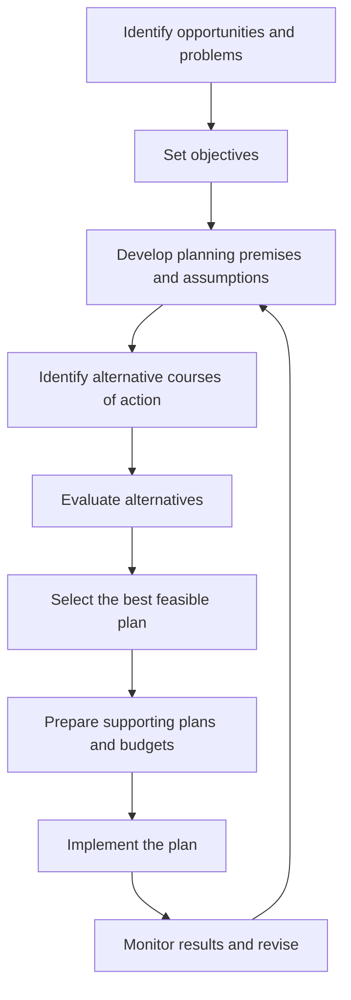
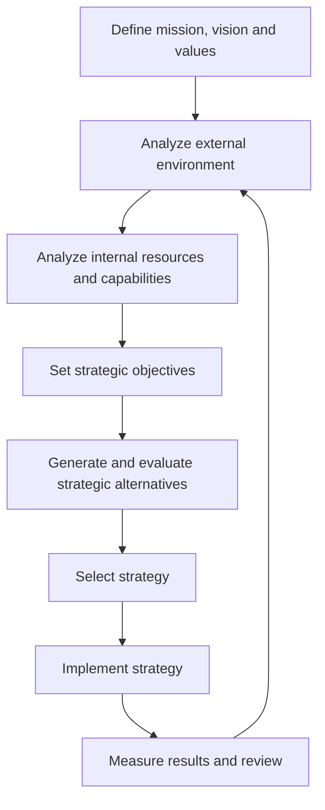
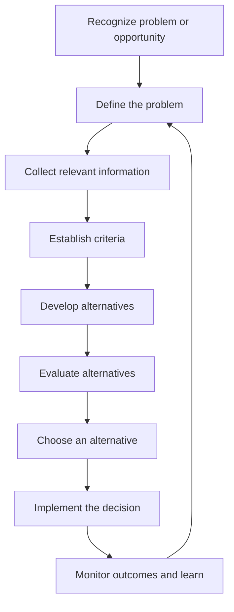

# Principles of Management — Exam-Oriented Notes
## B.Tech CSE | Business Organization, Organization Culture and Environment, Planning, and Decision-Making

> **Scope note:** These notes cover the syllabus supplied: types of business organization (sole proprietorship, partnership, company, public and private sector enterprises); organizational culture and environment; current trends and issues in management; and Unit II, Planning and Decision-Making. They are written in straightforward English for university examination preparation.

## Table of Contents
1. [Types of Business Organization](#1-types-of-business-organization)
   - Sole Proprietorship
   - Partnership
   - Company
   - Public and Private Sector Enterprises
2. [Organization Culture and Environment](#2-organization-culture-and-environment)
3. [Current Trends and Issues in Management](#3-current-trends-and-issues-in-management)
4. [Unit II — Planning](#4-unit-ii--planning)
   - Nature and Purpose of Planning
   - Planning Process and Types
   - Objectives and Setting Objectives
   - Policies and Planning Premises
   - Strategic Management
   - Planning Tools and Techniques
5. [Decision-Making](#5-decision-making)
   - Steps and Process
   - Types of Decisions
   - Decision-Making Conditions
   - Decision-Making Styles
   - Effective Decision-Making
6. [Important Examination Questions and Model Answers](#6-important-examination-questions-and-model-answers)
7. [Quick Revision Tables](#7-quick-revision-tables)
8. [Syllabus Coverage Checklist](#8-syllabus-coverage-checklist)

---

# 1. Types of Business Organization

## 1.1 Meaning of Business Organization

A **business organization** is a structured arrangement of people, capital, resources, and activities established to produce or provide goods and services and achieve specified objectives. These objectives may include earning profit, providing public services, creating employment, or meeting a social need.

The form of organization determines who owns the business, who controls it, how profits are distributed, how much liability owners bear, how capital is raised, and how long the organization can continue.

### Factors affecting the choice of business organization
1. **Nature and size of business:** A small local shop may suit sole proprietorship, while a large manufacturing business may need a company.
2. **Capital requirement:** Businesses requiring substantial funds may prefer a company because it can raise capital from multiple investors.
3. **Liability:** Owners should consider whether personal assets may be used to pay business debts.
4. **Control:** A sole proprietor has direct control; a company generally separates ownership and management.
5. **Continuity:** Some forms depend on the existence of particular owners, while a company usually has continuity independent of changes in shareholders.
6. **Legal formalities:** Registration, reporting, and compliance requirements vary by form.
7. **Confidentiality:** A small owner-managed business may keep internal decisions more private than a widely held company.
8. **Risk sharing:** Partnerships and companies can distribute financial risk among multiple owners, subject to the applicable law.
9. **Government objectives:** Public enterprises may be established to provide essential services, develop infrastructure, or serve strategic national interests.

## 1.2 Sole Proprietorship

### Definition
A **sole proprietorship** is a business owned, managed, and generally controlled by one person, who receives its profits and bears its business risks and liabilities.

### Main characteristics
1. **Single ownership:** One person owns the business.
2. **Direct control:** The owner usually makes important decisions and supervises operations.
3. **Unlimited liability:** In the traditional form, the owner's personal assets may be used to meet business debts if business assets are insufficient, subject to applicable law.
4. **No separate legal identity in the usual traditional form:** The business and proprietor are not treated as fully separate legal persons in the same way as a company.
5. **Profit belongs to the owner:** After expenses and obligations, the profit goes to the proprietor.
6. **Business secrecy:** The owner can often keep business methods and financial information relatively confidential.
7. **Limited capital:** Funds are mainly drawn from personal savings, loans, and business earnings.
8. **Personalized service:** The owner can build direct relationships with customers.
9. **Limited continuity:** Illness, death, or inability of the proprietor may disrupt or end the business, unless arrangements are made to continue it.
10. **Simple formation and closure:** Compared with a company, starting and closing a small proprietorship is often relatively simple, although licenses and tax registrations may still be required.

### Advantages
- **Quick decisions:** There is usually no need to consult co-owners.
- **Strong motivation:** The owner directly benefits from successful performance.
- **Low organizational cost:** Administrative and formation costs are generally lower.
- **Flexibility:** The business can respond quickly to customer needs and market changes.
- **Confidentiality:** Less information may need to be shared with outside owners.
- **Close customer contact:** Personal service can help build loyalty.

### Disadvantages
- **Limited financial resources:** One person's funds and borrowing capacity may restrict growth.
- **Unlimited liability:** Personal wealth may be at risk for business debts.
- **Limited managerial expertise:** One individual may not have expertise in every business function.
- **Heavy workload:** The owner may have to manage purchasing, accounts, sales, staffing, and customer service.
- **Limited continuity:** The business may depend heavily on the owner.
- **Limited expansion:** Large projects may require more capital and specialist management than one person can provide.

### Examples
A neighborhood grocery shop, small tailoring service, independent tutor, or local repair shop may operate as a sole proprietorship. The legal status of any specific business depends on how it is registered and operated.

### When is it suitable?
It is generally suitable for small businesses requiring modest capital, close personal supervision, quick decisions, and direct customer interaction.

## 1.3 Partnership

### Definition
A **partnership** is a relationship between two or more persons who agree to carry on a business and share its profits, with the applicable legal framework determining their rights, duties, and liabilities.

In India, the Indian Partnership Act, 1932 is a key statute governing traditional partnerships. The exact legal consequences depend on the type of entity and applicable law.

### Main characteristics
1. **Two or more persons:** A partnership involves more than one partner; statutory limits and conditions apply.
2. **Agreement:** The relationship is created through an agreement, which may be written or oral, although a written partnership deed is strongly advisable.
3. **Profit-sharing:** Partners agree on how profits and losses are shared.
4. **Mutual agency:** In a traditional partnership, a partner may act as an agent of the firm and other partners for business purposes, within the legal rules.
5. **Shared management:** Partners may jointly manage the business or assign different responsibilities.
6. **Shared resources:** Partners may contribute capital, skills, contacts, and experience.
7. **Liability:** In a traditional general partnership, partners can have unlimited liability for firm obligations, subject to law.
8. **Good faith:** Partners are expected to act honestly toward one another and follow their legal and contractual duties.
9. **Continuity may be affected:** A partner's death, retirement, or insolvency can affect the firm, depending on the agreement and law.
10. **Partnership deed:** A deed commonly states the firm name, business, capital contributions, profit/loss ratio, duties, remuneration, interest, admission or retirement rules, dispute resolution, and dissolution procedures.

### Types of partners
- **Active or working partner:** Participates in daily management.
- **Sleeping or dormant partner:** Invests and shares profits but does not normally take part in daily operations.
- **Nominal partner:** Allows their name to be associated with the firm, with legal consequences depending on the circumstances.
- **Partner by estoppel or holding out:** A person who represents themselves, or knowingly permits themselves to be represented, as a partner may incur liability to third parties under applicable law.
- **Minor admitted to benefits:** Under Indian partnership law, a minor cannot be a full partner but may be admitted to the benefits of an existing partnership under the relevant conditions.

### Advantages
- **More capital than sole proprietorship:** Several partners can contribute funds.
- **Combined expertise:** Partners can bring different skills.
- **Shared workload:** Responsibilities can be divided.
- **Flexible operations:** A partnership may be less complex to manage than a large company.
- **Risk sharing:** Financial burden and business responsibilities can be distributed.
- **Personal interest:** Partners are often directly involved in performance.

### Disadvantages
- **Potentially unlimited liability:** General partners may face personal liability for firm obligations.
- **Possibility of conflict:** Partners may disagree about strategy, money, or responsibilities.
- **Slower decisions:** Consultation may be required.
- **Limited capital compared with large companies:** Fundraising may remain constrained.
- **Continuity concerns:** Changes in partnership membership may affect the firm.
- **Risk of another partner's actions:** Mutual agency can mean one partner's authorized business actions affect the firm and other partners.

### Partnership deed: typical contents
1. Name and address of the firm.
2. Names and addresses of partners.
3. Nature and location of business.
4. Capital contribution of each partner.
5. Profit and loss sharing ratio.
6. Duties, powers, and decision rights.
7. Partner salary, commission, or interest arrangements.
8. Rules for admission, retirement, or death of a partner.
9. Accounting year and maintenance of records.
10. Procedure for dispute resolution and dissolution.

### Partnership versus sole proprietorship
| Basis | Sole proprietorship | Partnership |
|---|---|---|
| Owners | One | Two or more, subject to law |
| Capital | Mainly one owner's resources | Contributions from several partners |
| Decision-making | Usually fast and centralized | Shared or agreed among partners |
| Expertise | Depends heavily on one owner | Skills can be combined |
| Liability | Generally unlimited for proprietor | Generally unlimited for partners in a traditional firm |
| Profit | Belongs to proprietor | Shared according to agreement |
| Continuity | Often owner-dependent | May be affected by partner changes |
| Conflict potential | No co-owner conflict | Disagreements may arise among partners |

## 1.4 Company

### Definition
A **company** is an incorporated legal entity formed under company law. It has a legal identity separate from its members, can own property and enter contracts in its own name, and continues according to the rules governing the entity.

In India, companies are principally governed by the Companies Act, 2013, together with applicable rules and regulations.

### Main characteristics
1. **Separate legal entity:** The company is legally distinct from its shareholders.
2. **Limited liability in common share structures:** Shareholders' liability is generally limited to the amount unpaid on their shares or the guarantee they have undertaken, depending on company type and law.
3. **Perpetual succession:** The company can continue despite the death, insolvency, or transfer of shares by a member.
4. **Ownership through shares:** In a share-capital company, ownership interests are represented by shares.
5. **Separation of ownership and management:** Shareholders own the company, while directors and executives manage it under legal and governance rules.
6. **Transferability of ownership:** Shares may be transferable, subject to the law and the company's type and governing documents.
7. **Ability to raise capital:** Depending on its form, a company may raise funds from shareholders, lenders, and other permitted sources.
8. **Legal compliance:** Companies must meet applicable incorporation, accounting, filing, governance, and disclosure requirements.
9. **Formal decision-making:** Board meetings, shareholder meetings, and documented procedures may be required.
10. **Common seal is not universally compulsory:** Modern company law does not make a common seal mandatory in every case.

### Main types of company
- **Private company:** Its articles restrict the right to transfer shares, limit membership as prescribed by law, and prohibit invitations to the public to subscribe for its securities. Exact statutory requirements should be checked against current law.
- **Public company:** A company that is not a private company and meets the applicable legal requirements. A public company is not necessarily government-owned.
- **One Person Company (OPC):** A company structure that can be formed with one member under Indian company law, subject to applicable requirements.
- **Company limited by shares:** Members' liability is generally limited to the unpaid amount on their shares.
- **Company limited by guarantee:** Members undertake to contribute a specified amount if the company is wound up, as provided by its constitution and law.
- **Unlimited company:** Members' liability is not limited in the same manner as in limited companies.

### Advantages
- **Limited liability:** In a limited company, members' personal liability is generally restricted as prescribed by law.
- **Large capital base:** A company can pool funds from multiple investors and lenders.
- **Continuity:** The entity can continue despite changes in membership.
- **Professional management:** Specialists can be appointed to manage operations.
- **Growth potential:** The structure can support expansion and complex operations.
- **Transfer of ownership:** Shares can be transferred under applicable rules.
- **Credibility and governance:** Formal records and governance processes may improve confidence among lenders, suppliers, and investors.

### Disadvantages
- **Formation costs and formalities:** Incorporation and compliance involve procedures and expense.
- **Regulatory burden:** Filing, accounting, audit, and governance duties can be extensive.
- **Less confidentiality:** Certain company information must be disclosed.
- **Separation can create agency problems:** Managers may not always act exactly as shareholders expect.
- **Slower formal decisions:** Major matters may require board or shareholder procedures.
- **Ownership dilution:** Raising capital by issuing shares can reduce existing owners' proportionate control.

### Company versus partnership
| Basis | Company | Traditional partnership |
|---|---|---|
| Legal status | Separate incorporated legal entity | Firm's legal position differs from that of a company |
| Formation | Incorporation under company law | Partnership agreement under partnership law |
| Liability | Often limited for shareholders, depending on type | Generally unlimited for partners in a general partnership |
| Ownership | Shareholders or members | Partners |
| Management | Directors and appointed managers | Partners or appointed agents |
| Continuity | Usually perpetual succession | May be affected by partner changes, subject to law and agreement |
| Compliance | Generally more formal statutory requirements | Usually fewer formalities than a company |
| Capital raising | Can access share-based capital where permitted | Usually relies on partners and borrowing |

## 1.5 Public-Sector Enterprises

### Definition
A **public-sector enterprise (PSE)** is an enterprise owned, controlled, or substantially influenced by the government and established to carry out commercial, developmental, strategic, or public-service objectives.

Public-sector enterprises may operate at the central, state, or local level. Their legal forms and ownership arrangements vary.

### Objectives
1. Provide essential goods and services.
2. Build infrastructure that requires large, long-term investment.
3. Support strategic sectors and national security.
4. Promote balanced regional development.
5. Create employment and develop technical skills.
6. Prevent or reduce monopolistic exploitation in important sectors.
7. Support social welfare and access to basic services.
8. Develop industries where private investment may be insufficient.

### Common forms
- **Departmental undertaking:** Operates as part of a government department; the government has direct administrative control.
- **Statutory corporation:** Created by a specific law that defines its powers, duties, and structure.
- **Government company:** A company in which government ownership meets the threshold defined by applicable company law; it is incorporated under company legislation.

### Advantages
- Can undertake large infrastructure projects.
- May provide services where social benefit is more important than immediate profit.
- Can support strategic and regional development.
- May have access to government resources or guarantees where authorized.
- Can create employment and build domestic capacity.

### Disadvantages and challenges
- Excessive administrative control may slow decisions.
- Political interference may affect commercial decisions.
- Weak accountability can reduce efficiency.
- Some enterprises may face soft budget constraints or recurring losses.
- Procurement and staffing processes can be less flexible.
- Balancing public service with commercial performance can be difficult.

### Examples
Examples often discussed in India include Indian Railways as a departmental undertaking, and government-controlled companies such as NTPC or ONGC. The precise classification and ownership status of an organization can change over time, so use current official information when a question asks for current status.

## 1.6 Private-Sector Enterprises

### Definition
A **private-sector enterprise** is a business owned and controlled by private individuals, partnerships, companies, or other non-government entities, operating under applicable laws.

### Objectives
- Earn profit and provide returns to owners or investors.
- Meet customer needs.
- Increase market share and competitiveness.
- Innovate and improve productivity.
- Expand operations and create employment.
- Build long-term value and business continuity.

### Advantages
- Competitive pressure can encourage efficiency and innovation.
- Decisions may be faster when authority is decentralized or ownership is concentrated.
- Businesses can respond to customer preferences.
- Performance incentives can motivate employees and managers.
- Private capital can support new products and services.

### Disadvantages and challenges
- Profit goals may conflict with social or environmental interests.
- Services may be underprovided where customers cannot pay enough to cover costs.
- Market power can lead to unfair pricing or reduced competition.
- Short-term financial pressure may discourage long-term investment.
- Job security and employee welfare can vary by organization.
- Firms may underinvest in public goods unless incentives or regulation encourage it.

### Public sector versus private sector
| Basis | Public sector | Private sector |
|---|---|---|
| Ownership/control | Government ownership or control | Private ownership/control |
| Main objectives | Public service, development, strategic needs, and financial sustainability | Profit, customer value, growth, and returns |
| Accountability | Public authorities, law, audit, and citizens, depending on entity | Owners, investors, regulators, customers, and law |
| Funding | Government funds, revenue, borrowing, or mixed sources | Private capital, retained earnings, and borrowing |
| Decision-making | May involve public procedures and oversight | Often more commercially flexible, depending on governance |
| Performance criteria | Public value plus operational and financial performance | Financial performance, customer value, and legal/social obligations |
| Typical challenge | Bureaucracy and political interference | Profit pressure, market power, and externalities |

**Important distinction:** A public company is not the same thing as a public-sector enterprise. “Public company” describes a legal company category; “public sector” describes government ownership or control. A public company can be privately owned, and a government-owned company can have a corporate legal form.

## 1.7 Choosing an appropriate business form

A useful decision process is:
1. Define the size and nature of the business.
2. Estimate start-up and future capital needs.
3. Evaluate acceptable personal liability.
4. Decide how much control the founders want to retain.
5. Consider the need for continuity and ownership transfer.
6. Compare legal, tax, reporting, and compliance obligations.
7. Assess the need for specialist management and external investors.
8. Select a form and obtain appropriate professional advice where required.

**Example:** A student starting a small freelance web-design service may begin as a sole proprietor. If several founders build a software product and need outside investment, a company may be more appropriate because it can provide a clearer ownership structure and support investment. The correct form depends on risk, scale, funding, and legal requirements.

---

# 2. Organization Culture and Environment

## 2.1 Organizational Culture

### Definition
**Organizational culture** is the shared set of values, beliefs, assumptions, norms, and ways of behaving that influence how people work, make decisions, communicate, and respond to problems within an organization.

In simple terms, culture is “how work is normally done here.” It is reflected in both formal statements and everyday behavior.

### Elements of organizational culture
1. **Values:** Principles the organization considers important, such as integrity, safety, innovation, or customer service.
2. **Beliefs:** Ideas employees hold about what leads to success and how people should work.
3. **Basic assumptions:** Deeply held, often unspoken ideas—for example, whether employees can be trusted to take responsibility.
4. **Norms:** Informal expectations about behavior, punctuality, collaboration, and communication.
5. **Symbols:** Logos, office design, uniforms, awards, and other visible signs.
6. **Stories and legends:** Accounts of founders, major successes, failures, or employee actions that communicate expected behavior.
7. **Rituals and routines:** Regular meetings, onboarding, celebrations, recognition events, and review processes.
8. **Language:** Terms, expressions, and technical vocabulary used by members.
9. **Leadership behavior:** Managers demonstrate which values are genuinely rewarded or tolerated.
10. **Systems and practices:** Hiring, promotion, performance appraisal, rewards, and disciplinary procedures reinforce culture.

### Levels of culture: a useful framework
A commonly used framework distinguishes three levels:

1. **Artifacts:** Visible aspects such as dress, office layout, ceremonies, and observable behavior. They are easy to see but may be difficult to interpret correctly.
2. **Espoused values:** Values and principles the organization publicly says it follows, such as teamwork or customer focus.
3. **Underlying assumptions:** Deep, taken-for-granted beliefs that shape behavior.

**Example:** A software company may display “innovation” on its website (espoused value). Employees' experiments and demo days are artifacts. If employees truly believe that reasonable failure is part of learning and managers do not punish every unsuccessful experiment, that belief is an underlying assumption.

### Types or patterns of organizational culture
Different textbooks classify culture in different ways. Common patterns include:

- **Power culture:** Authority is concentrated around a central person or small group. Decisions can be fast, but excessive dependence on leaders can be risky.
- **Role culture:** Work is organized through defined jobs, procedures, and hierarchy. It supports consistency but can become bureaucratic.
- **Task culture:** Teams are formed to solve problems or complete projects. Expertise and results are emphasized.
- **Person culture:** Individual professionals and their independence are central. This can occur in some specialist or professional settings.
- **Clan culture:** Emphasizes collaboration, participation, mentoring, and a family-like sense of belonging.
- **Adhocracy or innovation culture:** Values experimentation, flexibility, creativity, and risk-taking.
- **Market or results-oriented culture:** Focuses strongly on competition, targets, customers, and measurable outcomes.
- **Hierarchy culture:** Values stability, control, standard procedures, and predictable operations.

These labels come from different models and should not be treated as one universally accepted classification.

### Functions and importance of organizational culture
1. **Creates identity:** Employees understand what the organization stands for.
2. **Guides behavior:** Shared norms help employees decide how to act when rules do not cover every situation.
3. **Improves coordination:** Common expectations reduce confusion between teams.
4. **Supports motivation and belonging:** A respectful culture can increase engagement and retention.
5. **Shapes decisions:** Values influence how managers balance speed, quality, safety, ethics, and cost.
6. **Encourages innovation:** A culture that supports ideas and learning can help an organization adapt.
7. **Maintains standards:** Strong safety or quality norms can reduce errors.
8. **Communicates priorities:** Reward systems and leader behavior reveal what is genuinely important.

### Advantages of a strong, constructive culture
- Employees can coordinate with less constant supervision.
- Shared values can strengthen trust and commitment.
- New employees can learn expected behavior more easily.
- A culture of learning can improve adaptation and innovation.
- Ethical norms can help prevent misconduct.

### Risks of a strong but unhealthy culture
- Employees may conform even when they see a problem.
- Groupthink can discourage critical questioning.
- A culture may resist necessary change.
- “Fit” may be used to exclude people with different backgrounds or perspectives.
- Unethical practices can become normalized if high performance is rewarded regardless of methods.

**Key point:** A strong culture is not automatically a good culture. Its quality depends on what behaviors and values it reinforces.

### How managers develop and change culture
1. Define the desired values in practical terms.
2. Demonstrate those values through leadership behavior.
3. Recruit and onboard people fairly and clearly.
4. Align incentives and performance reviews with desired behavior.
5. Encourage open communication and constructive disagreement.
6. Recognize behavior that reflects the culture.
7. Address conduct that contradicts stated values consistently.
8. Measure culture through surveys, interviews, retention, incidents, and employee feedback.
9. Review culture as technology, customers, and society change.

### Example
A cybersecurity firm claims that security is its top priority. If managers reward employees for meeting deadlines while ignoring security reviews, the real culture rewards speed rather than security. To create a genuine security culture, the firm must allocate time for reviews, reward responsible reporting, and ensure that employees can raise concerns without retaliation.

## 2.2 Organizational Environment

### Definition
The **organizational environment** consists of internal and external forces, conditions, and stakeholders that affect an organization's decisions, performance, and ability to achieve its objectives.

Managers study the environment to identify opportunities, threats, resource constraints, and changes that require action.

### A. Internal environment
The internal environment includes factors within the organization that managers can usually influence more directly.

- **Employees and skills:** Knowledge, experience, motivation, and workforce diversity.
- **Management and leadership:** Leadership style, decision processes, and managerial capability.
- **Organizational structure:** Reporting relationships, authority, and coordination.
- **Culture:** Shared norms and values.
- **Financial resources:** Cash, budgets, access to capital, and cost structure.
- **Technology and systems:** Software, equipment, data, and operating processes.
- **Physical resources:** Buildings, equipment, and facilities.
- **Policies and procedures:** Rules governing work and decisions.

### B. External environment
The external environment includes forces outside the organization's direct control.

#### 1. Task or specific environment
These are actors that directly affect the organization's day-to-day operations:
- Customers and users.
- Competitors.
- Suppliers.
- Distributors and business partners.
- Investors and lenders.
- Regulators and government agencies.
- Labor markets and professional communities.

#### 2. General or macro environment
A common framework is **PESTLE**:

| Factor | Meaning | Example for a software company |
|---|---|---|
| Political | Government priorities and political stability | Public digital-infrastructure investment |
| Economic | Inflation, interest rates, growth, employment, currency movements | A slowdown reduces customer spending |
| Social | Demographics, culture, lifestyle, education, expectations | Customers expect accessible digital services |
| Technological | New tools, automation, cybersecurity, infrastructure | Generative AI changes software development |
| Legal | Laws and regulations | Data protection, employment, and intellectual-property rules |
| Environmental | Climate, energy use, waste, sustainability | Data centers face energy and cooling constraints |

Some textbooks use PEST rather than PESTLE; PESTLE adds legal and environmental dimensions explicitly.

### Environmental uncertainty
Environmental uncertainty arises when managers lack enough information to predict external changes confidently. It tends to increase when:
- **Complexity is high:** Many different forces influence the organization.
- **Dynamism is high:** Conditions change rapidly or unpredictably.

A stable, simple environment is generally easier to forecast than a complex, rapidly changing one.

### Importance of environmental analysis
1. Identifies opportunities and threats.
2. Improves planning and strategic choices.
3. Helps anticipate customer and competitor changes.
4. Supports risk management and continuity planning.
5. Helps allocate resources to important developments.
6. Improves compliance with laws and standards.
7. Helps an organization adapt to technological and social change.

### SWOT analysis
**SWOT** stands for:
- **Strengths:** Internal advantages.
- **Weaknesses:** Internal limitations.
- **Opportunities:** Favorable external conditions.
- **Threats:** External risks.

| Internal factors | External factors |
|---|---|
| Strengths | Opportunities |
| Weaknesses | Threats |

**Worked example — a small software startup**
- Strength: skilled development team.
- Weakness: limited marketing budget.
- Opportunity: rising demand for digital services among small businesses.
- Threat: established competitors and rapid technology changes.

A useful SWOT analysis should lead to actions. For example, the startup might use its technical strength to serve a focused customer segment rather than trying to compete with large firms on every feature.

### Culture versus environment
| Basis | Organizational culture | Organizational environment |
|---|---|---|
| Meaning | Shared internal values and norms | Internal and external conditions affecting the organization |
| Main focus | How members think and behave | Forces and stakeholders influencing operations |
| Examples | Openness, teamwork, risk tolerance | Competitors, regulations, inflation, technology |
| Managerial influence | Can be shaped over time through leadership and systems | Internal conditions can be changed; external forces usually must be monitored and responded to |
| Main question | “How do we do things here?” | “What conditions affect our performance?” |

---

# 3. Current Trends and Issues in Management

Management practices change as technology, workforce expectations, markets, and social responsibilities evolve. The following are broad contemporary trends rather than a prediction of what any one organization must adopt.

## 3.1 Digital transformation
**Digital transformation** means using digital technologies to redesign processes, services, decisions, and sometimes the organization's business model—not merely purchasing new software.

Examples include cloud-based collaboration, digital customer service, automated workflows, analytics dashboards, and online delivery of services.

**Benefits:** Faster processes, better access to information, new services, and improved customer experience.

**Issues:** High implementation cost, cybersecurity risk, integration difficulties, employee resistance, and the need for digital skills.

## 3.2 Artificial intelligence and automation
AI systems can support forecasting, customer support, document processing, software development, quality inspection, and decision analysis.

**Management opportunities**
- Automate repetitive work.
- Analyze large datasets.
- Support forecasting and personalization.
- Improve productivity when tools are appropriately selected and supervised.

**Management issues**
- Biased or inaccurate outputs.
- Privacy and security risks.
- Unclear accountability.
- Overreliance on automated recommendations.
- Job redesign and reskilling needs.
- Intellectual-property and regulatory concerns.

**Good practice:** Keep humans accountable for consequential decisions, verify AI outputs, protect sensitive data, and evaluate whether automation actually improves outcomes.

## 3.3 Data-driven management
Data-driven management uses reliable evidence, metrics, experiments, and analysis to support decisions.

**Benefits:** More transparent performance measurement, earlier detection of problems, and better evaluation of alternatives.

**Risks:** Poor-quality data, misleading metrics, privacy violations, and ignoring important qualitative factors. Managers should use data alongside professional judgment rather than assuming that every important issue can be reduced to a number.

## 3.4 Agile management and flexible work
Agile approaches emphasize short work cycles, feedback, collaboration, and adapting plans as new information appears. Flexible work includes remote, hybrid, and flexible-schedule arrangements.

**Benefits:** Faster learning, broader recruitment, and potentially better work-life flexibility.

**Issues:** Coordination across time zones, reduced informal communication, unequal visibility, isolation, and difficulty evaluating output fairly.

Managers should set clear goals, document decisions, support inclusion, and assess results rather than simply measuring visible activity.

## 3.5 Diversity, equity, inclusion, and belonging
A diverse workforce includes people with different experiences and backgrounds. Inclusion means people can participate meaningfully, and fair processes reduce avoidable barriers.

**Potential benefits:** Broader perspectives, better understanding of different customers, and stronger problem-solving.

**Issues:** Bias in recruitment or promotion, tokenism, inaccessible processes, and unresolved interpersonal conflict.

Useful practices include structured hiring criteria, accessible communication, fair development opportunities, and safe channels for reporting concerns.

## 3.6 Employee well-being and mental health
Management increasingly considers workload, psychological safety, reasonable flexibility, and employee support.

**Why it matters:** Chronic overload can contribute to mistakes, absenteeism, turnover, and lower-quality work.

**Managerial responses:** Set realistic priorities, clarify roles, provide appropriate resources, train managers, and create a workplace where employees can raise problems early. Well-being initiatives cannot replace fixing excessive workload or harmful management practices.

## 3.7 Sustainability and social responsibility
**Corporate social responsibility (CSR)** concerns an organization's responsibilities toward society and stakeholders, beyond immediate profit. **Sustainability** includes the long-term environmental, social, and economic effects of organizational decisions.

Examples include reducing energy use, managing waste, improving supply-chain standards, and designing durable products.

**Issues:** Initial costs, trade-offs, measurement difficulty, greenwashing, and competing stakeholder demands. Credible reporting should use measurable targets and evidence.

## 3.8 Ethics, governance, and accountability
Ethical management involves fairness, honesty, respect, compliance, and accountability. Corporate governance concerns the systems through which an organization is directed, controlled, and held accountable.

Common issues include conflicts of interest, bribery, misleading reporting, misuse of customer data, harassment, and pressure to meet targets by improper means.

Managers can reduce these risks through clear standards, transparent decisions, independent oversight where appropriate, and protected reporting channels.

## 3.9 Globalization and cross-cultural management
Globalization connects organizations to international markets, suppliers, employees, and competitors.

**Opportunities:** Larger markets, access to specialized talent, and diversified supply sources.

**Challenges:** Cultural differences, time zones, currency changes, geopolitical risk, differing laws, and supply-chain disruptions.

Managers should communicate expectations clearly and avoid assuming that one communication style or management practice works equally well in every culture.

## 3.10 Cybersecurity and privacy
Organizations depend on information systems and therefore face risks from phishing, ransomware, data theft, insecure software, and misuse of personal information.

Management responsibilities include risk assessment, access controls, staff training, incident-response plans, backups, vendor evaluation, and privacy-aware data handling. Cybersecurity is a management and governance issue as well as a technical issue.

## 3.11 Change management and resistance
Employees may resist change because of uncertainty, fear of job loss, lack of trust, inadequate skills, or previous failed initiatives.

Effective change management includes:
1. Explaining why change is needed.
2. Involving affected employees.
3. Providing training and support.
4. Setting realistic milestones.
5. Listening to feedback.
6. Measuring results and correcting problems.

## 3.12 Talent management and continuous learning
Technology and market changes can make existing skills outdated. Organizations increasingly need continuous learning, internal mobility, mentoring, and reskilling.

The challenge is to make learning relevant, accessible, and connected to actual work rather than treating it as a one-time training event.

## 3.13 Common management issues
- Balancing short-term results with long-term capability.
- Managing conflict between stakeholders.
- Maintaining quality while reducing costs.
- Preventing discrimination and unethical conduct.
- Adapting to unpredictable external changes.
- Making decisions with incomplete information.
- Protecting confidential data.
- Retaining skilled employees.
- Measuring performance without encouraging harmful behavior.
- Maintaining trust during organizational change.

### Conclusion
Modern management requires more than traditional planning and supervision. Managers must combine clear objectives, ethical judgment, evidence-based decisions, adaptability, employee development, and responsible use of technology. The appropriate response depends on the organization's size, sector, resources, and environment.

---

# 4. Unit II — Planning

## 4.1 Meaning and Definition of Planning

**Planning** is the managerial function of deciding in advance what is to be done, why it is to be done, how it will be done, when it will be done, and who will do it.

Planning connects organizational objectives with the actions and resources needed to achieve them. It is future-oriented, but it must be based on current information and assumptions.

### Example
A college technical club wants to conduct a hackathon. Planning involves setting the number of participants, selecting a date, estimating costs, arranging judges and venues, assigning responsibilities, promoting the event, and preparing backup arrangements.

## 4.2 Nature or Characteristics of Planning

1. **Goal-oriented:** Planning is directed toward defined objectives.
2. **Primary managerial function:** It provides direction for organizing, staffing, leading, and controlling. It does not mean other functions are unimportant.
3. **Pervasive:** Managers at different levels plan, although the scope and time horizon differ.
4. **Future-oriented:** It anticipates likely conditions and prepares actions.
5. **Involves decision-making:** Planners choose among alternatives.
6. **Intellectual process:** It requires analysis, judgment, creativity, and forecasting.
7. **Continuous:** Plans must be reviewed as circumstances change.
8. **Involves uncertainty:** Future conditions cannot be known perfectly.
9. **Flexible:** A useful plan can be revised when assumptions or conditions change.
10. **Efficiency-oriented:** Planning can reduce waste, duplication, and avoidable delays.
11. **Interdependent:** Departmental plans should support overall organizational objectives.
12. **Based on premises:** Plans depend on assumptions about future conditions, resources, and constraints.

## 4.3 Purpose and Importance of Planning

- **Provides direction:** Employees know what outcomes are expected.
- **Reduces uncertainty:** Forecasting and contingency plans prepare the organization for possible changes.
- **Improves coordination:** Departments can align their activities.
- **Reduces waste:** Resources can be assigned before work begins.
- **Supports control:** Actual performance can be compared with planned targets.
- **Encourages innovation:** Comparing alternatives can reveal better approaches.
- **Improves resource allocation:** Money, time, people, and equipment can be prioritized.
- **Supports growth:** Long-term goals can be translated into practical stages.
- **Clarifies accountability:** Responsibilities and deadlines can be assigned.

### Limitations of planning
1. **Forecasts may be wrong:** Unanticipated events can invalidate assumptions.
2. **Can be costly and time-consuming:** Data gathering and coordination require resources.
3. **May create rigidity:** Strict adherence can prevent timely adaptation.
4. **Can discourage creativity if overformalized:** Employees may focus only on the written plan.
5. **Depends on information quality:** Poor data can produce poor plans.
6. **Does not guarantee success:** Implementation, leadership, resources, and external conditions still matter.
7. **May face resistance:** Employees may not support plans imposed without consultation.
8. **Can create false confidence:** A detailed plan can appear more certain than the evidence justifies.

**Conclusion:** Planning is essential because it gives coordinated direction and prepares an organization for the future. It is most effective when based on realistic assumptions and reviewed regularly.

## 4.4 Planning Process

A common planning process is shown below. The exact number and names of stages vary across textbooks, but the logic is similar.



### Step 1: Identify opportunities and problems
Examine customer needs, organizational performance, available resources, and external changes. A plan should address a real need or opportunity.

### Step 2: Set objectives
Define the desired results. Objectives should be clear enough to guide action and measure progress.

### Step 3: Establish planning premises
Planning premises are assumptions about conditions in which the plan will operate. Examples include expected demand, available budget, labor supply, technology, and government policy.

### Step 4: Identify alternatives
Generate possible ways to achieve the objective. Avoid settling on the first idea before considering viable alternatives.

### Step 5: Evaluate alternatives
Compare options by cost, time, risk, feasibility, resource needs, quality, ethical effects, and expected results.

### Step 6: Select a course of action
Choose the alternative that best meets the objectives within the available constraints. Sometimes a combination of alternatives is best.

### Step 7: Develop supporting plans and budgets
Prepare departmental plans, schedules, staffing arrangements, procurement plans, communication plans, and budgets needed to make the main plan workable.

### Step 8: Implement
Assign responsibilities, communicate expectations, provide resources, and start the planned activities.

### Step 9: Monitor and revise
Compare actual results with targets. If performance deviates, identify the cause and revise actions or assumptions where necessary.

### Worked example: planning a student hackathon
- **Objective:** Conduct a one-day event for 150 students within a fixed budget.
- **Premises:** Venue capacity, sponsor support, internet availability, and participant demand.
- **Alternatives:** On-campus or external venue; online or physical judging.
- **Evaluation:** Compare cost, accessibility, reliability, and participant experience.
- **Plan:** Choose the feasible venue, prepare a budget, assign teams, and set deadlines.
- **Control:** Track registrations, expenses, and readiness; prepare backup internet and power arrangements.

## 4.5 Types of Planning

Planning can be classified by organizational level, time horizon, frequency, and scope.

### A. Strategic, tactical, and operational planning

| Basis | Strategic planning | Tactical planning | Operational planning |
|---|---|---|---|
| Main question | Where should the organization go? | How will a unit support the strategy? | What must be done in daily work? |
| Level | Top management, with wider participation as appropriate | Middle or functional management | Supervisors and operational teams |
| Time horizon | Usually long-term, but varies | Medium-term, often linked to annual plans | Short-term or day-to-day |
| Scope | Organization-wide | Department or function | Specific tasks and processes |
| Detail | Broad direction and priorities | Converts strategy into programs | Detailed procedures and schedules |
| Example | Enter a new market | Create a marketing and staffing plan | Schedule customer-support shifts |

### B. Standing and single-use plans

**Standing plans** are used repeatedly for recurring situations:
- **Policies:** General guidelines for decisions.
- **Procedures:** Ordered steps for carrying out recurring activities.
- **Rules:** Specific required or prohibited actions.

**Single-use plans** are designed for a particular objective or event:
- **Programs:** Coordinated activities, responsibilities, and schedules.
- **Projects:** Defined tasks with a specific deliverable and endpoint.
- **Budgets:** Quantified plans expressed in money, time, or other measurable units.

### C. Other useful classifications
- **Short-term plans:** Cover near-term operations; the exact duration depends on context.
- **Long-term plans:** Address more distant objectives and investments.
- **Formal plans:** Written, approved, and communicated.
- **Informal plans:** Less documented and often used in small or rapidly changing settings.
- **Contingency plans:** Specify alternative actions if an important assumption fails.
- **Directional plans:** Provide broad guidance and flexibility.
- **Specific plans:** Define clear targets and actions in detail.

## 4.6 Objectives

### Definition
An **objective** is a specific result that an individual, team, or organization intends to achieve within a stated period.

Objectives give direction and provide a basis for measuring performance.

### Importance of objectives
1. Clarify expected results.
2. Guide planning and resource allocation.
3. Help coordinate departments.
4. Provide standards for performance evaluation.
5. Motivate employees when targets are realistic and meaningful.
6. Support accountability.
7. Help managers prioritize competing tasks.

### Types of objectives
- **Strategic objectives:** Broad, long-term outcomes for the organization.
- **Tactical objectives:** Departmental or functional outcomes supporting strategy.
- **Operational objectives:** Specific results for teams, processes, or individuals.
- **Financial objectives:** Revenue, cost, profit, cash flow, or return targets.
- **Non-financial objectives:** Quality, safety, customer satisfaction, innovation, or employee development.
- **Short-term and long-term objectives:** Classified by time horizon.
- **Individual, team, and organizational objectives:** Classified by the level responsible for achievement.

### Setting objectives: step-by-step
1. Review the organization's mission and broader goals.
2. Analyze current performance and relevant environmental conditions.
3. Identify the key result that needs improvement.
4. Make the objective specific and measurable where possible.
5. Set a realistic deadline.
6. Confirm that the required resources and authority are available.
7. Assign responsibility.
8. Communicate the objective to those affected.
9. Establish progress measures and review dates.
10. Revise the objective if assumptions change substantially.

### SMART objectives
SMART is a common checklist:

- **S — Specific:** Clearly states what must be achieved.
- **M — Measurable:** Progress or completion can be assessed.
- **A — Achievable:** Possible with available resources and capability.
- **R — Relevant:** Supports important organizational priorities.
- **T — Time-bound:** Includes a deadline or time period.

**Weak objective:** “Improve the club's publicity.”

**SMART-style objective:** “Increase verified registrations for the next technical event from 80 to 120 by 15 December, using the approved promotion budget.”

The numbers in the example are illustrative, not universal benchmarks.

### Management by Objectives (MBO)
**Management by Objectives (MBO)** is a management approach in which managers and employees jointly establish agreed objectives, periodically review progress, and evaluate performance against the objectives.

Typical MBO process:
1. Establish organizational objectives.
2. Translate them into departmental objectives.
3. Agree on individual objectives with employees.
4. Develop action plans.
5. Monitor progress through periodic reviews.
6. Evaluate performance.
7. Provide feedback and agree on future objectives.

**Advantages:** Clear goals, participation, measurable performance, and better alignment.

**Limitations:** Excessive focus on measurable targets can neglect quality or teamwork; poorly designed targets can encourage gaming; frequent reviews require time.

## 4.7 Policies

### Definition
A **policy** is a general guideline that directs managerial thinking and decisions within an organization. It establishes boundaries while allowing judgment in situations that require discretion.

### Characteristics
- Guides decisions rather than always prescribing every step.
- Supports consistency across similar cases.
- Should align with organizational objectives and law.
- May apply to the whole organization or a specific department.
- Can be revised when conditions or priorities change.
- Should be communicated clearly and applied fairly.

### Types of policies
- **Organizational policies:** Apply broadly across the organization.
- **Departmental policies:** Apply to a function such as HR, finance, or IT.
- **Written/formal policies:** Documented and officially communicated.
- **Unwritten/informal policies:** Informal expectations that may influence behavior but can create ambiguity.
- **Originated policies:** Established by top management.
- **Appealed policies:** Developed through repeated decisions on matters referred upward.
- **Imposed policies:** Required by law, regulators, parent organizations, or other external authorities.

### Policy versus procedure versus rule
| Concept | Meaning | Example |
|---|---|---|
| Policy | General guideline for decisions | Customer data must be handled confidentially |
| Procedure | Steps for carrying out an activity | Steps to approve access to customer records |
| Rule | Specific requirement or prohibition | Do not share account passwords |
| Strategy | Broad integrated direction for achieving major objectives | Compete through secure, reliable software for small businesses |

### Advantages of policies
- Improve consistency.
- Reduce repeated decision effort.
- Clarify expected behavior.
- Support delegation by defining boundaries.
- Help new employees understand organizational expectations.

### Limitations
- Rigid policies may not fit every situation.
- Outdated policies can create risk.
- Too many policies can slow decisions.
- Vague policies may be interpreted inconsistently.

## 4.8 Planning Premises

### Definition
**Planning premises** are assumptions, forecasts, and expected conditions on which a plan is based. They describe the environment and constraints managers believe will exist while the plan is carried out.

### Examples
- Expected sales demand.
- Budget and cash availability.
- Future material prices.
- Availability of skilled employees.
- Interest rates or exchange rates.
- Technology readiness.
- Competitor behavior.
- Legal or regulatory requirements.

### Types of planning premises
1. **Internal premises:** Arise within the organization, such as budget, staffing, equipment, and production capacity.
2. **External premises:** Arise outside the organization, such as market demand, economic conditions, law, and competitors.
3. **Tangible or quantitative premises:** Can be measured numerically, such as expected sales volume or cost.
4. **Intangible or qualitative premises:** Harder to quantify, such as public confidence, employee morale, or political stability.
5. **Controllable premises:** Conditions management can influence to some extent, such as staff training or internal schedules.
6. **Uncontrollable premises:** Conditions management cannot directly control, such as a competitor's actions or a natural disaster.

### Importance
- Gives planners a shared basis for assumptions.
- Makes plans more realistic.
- Helps compare alternatives.
- Identifies risks that need monitoring.
- Makes it easier to revise plans when assumptions fail.

### Good practice
State important assumptions explicitly, distinguish facts from estimates, assign responsibility for monitoring them, and prepare contingency actions for assumptions that could cause major disruption.

## 4.9 Strategic Management

### Definition
**Strategic management** is the continuing process of analyzing an organization's internal capabilities and external environment, formulating major long-term choices, implementing them, and evaluating results so that the organization can achieve its mission and objectives.

It is broader than writing a strategic plan: it includes execution, learning, and revision.

### Importance
- Establishes long-term direction.
- Helps an organization respond to competition and environmental change.
- Aligns resources with priorities.
- Identifies strengths, weaknesses, opportunities, and threats.
- Supports sustainable competitive advantage.
- Improves coordination across departments.
- Encourages managers to consider future risks as well as immediate results.

### Strategic management process



#### 1. Mission, vision, and values
- **Mission:** The organization's present purpose—why it exists and whom it serves.
- **Vision:** A desired future state.
- **Values:** Principles guiding decisions and behavior.

#### 2. Environmental analysis
Study customers, competitors, suppliers, technology, law, economic conditions, and broader trends. Tools include PESTLE and competitor analysis.

#### 3. Internal analysis
Examine skills, technology, finances, brand, processes, culture, and other capabilities. SWOT can summarize key internal and external factors.

#### 4. Strategic objectives
Set long-term priorities and measurable outcomes.

#### 5. Strategy formulation
Develop and compare alternatives such as market penetration, product development, diversification, partnerships, cost leadership, or differentiation. The suitability of each depends on the organization.

#### 6. Strategy implementation
Translate the chosen strategy into budgets, structures, staffing, projects, communication, and performance measures.

#### 7. Evaluation and control
Compare actual outcomes with objectives, investigate differences, and revise the strategy or implementation.

### Levels of strategy
- **Corporate-level strategy:** Which businesses, industries, or markets should the organization participate in?
- **Business-level strategy:** How should a business compete in its chosen market?
- **Functional-level strategy:** How should functions such as marketing, HR, operations, finance, and IT support the business strategy?

### Common strategic approaches
- **Cost leadership:** Seek a lower cost structure while meeting required quality standards.
- **Differentiation:** Offer features or service that customers value and competitors do not easily replicate.
- **Focus strategy:** Concentrate on a defined customer group, geography, or niche.
- **Growth strategy:** Expand products, markets, capacity, or partnerships.
- **Stability strategy:** Continue the current direction when it remains suitable.
- **Retrenchment or turnaround:** Reduce scope or restructure to address serious performance problems.

### Strategic planning versus operational planning
| Basis | Strategic planning | Operational planning |
|---|---|---|
| Purpose | Long-term direction and major choices | Execution of specific activities |
| Scope | Organization-wide or business-wide | Team, department, process |
| Time | Longer horizon, context-dependent | Near-term and recurring |
| Detail | Broad priorities | Detailed tasks, schedules, standards |
| Main responsibility | Senior leadership with stakeholder input | Functional managers and operational teams |
| Example | Become a leading provider of secure campus software | Assign weekly development tasks and testing shifts |

### Limitations and challenges
- Long-term forecasts can be uncertain.
- Strategic analysis can be expensive.
- Plans can fail if implementation is weak.
- Employees may resist a strategy they do not understand.
- Leaders may become attached to a strategy despite changing evidence.
- A strategy can be copied or undermined by competitors.
- Excessive focus on the plan can reduce responsiveness.

## 4.10 Planning Tools and Techniques

Managers use different tools to forecast conditions, compare choices, allocate resources, and monitor progress. No single tool is suitable for every decision.

### A. Forecasting
**Forecasting** estimates future conditions using past data, current evidence, expert judgment, or models.

Types:
- **Qualitative forecasting:** Uses expert opinions, customer interviews, Delphi methods, or judgment when numerical data are limited.
- **Quantitative forecasting:** Uses numerical data and statistical methods such as trend analysis, moving averages, or regression.

**Example — simple moving average:** If sales for the last three months were 100, 120, and 110 units, the three-month moving average is:

\[
\frac{100+120+110}{3}=110 \text{ units}
\]

This assumes those three observations are an appropriate basis for the next estimate. It does not guarantee that next month's sales will be 110.

### B. Budgeting
A **budget** is a quantitative plan for a future period, commonly expressed in money but sometimes in units, time, or other measures.

Common budgets:
- Sales budget.
- Production or service-delivery budget.
- Operating expense budget.
- Cash budget.
- Capital expenditure budget.
- Flexible budget, adjusted for different activity levels.

**Benefits:** Coordinates spending, sets limits, allocates resources, and provides a basis for control.

**Limitations:** Estimates may be wrong; fixed budgets may become outdated; teams may negotiate easy targets or spend remaining funds unnecessarily.

### C. Break-even analysis
Break-even analysis estimates the activity level at which total revenue equals total cost.

For a simple single-product case:

\[
\text{Break-even quantity}=\frac{\text{Fixed Costs}}{\text{Selling Price per Unit}-\text{Variable Cost per Unit}}
\]

The denominator is the contribution per unit. This formula assumes a constant selling price and variable cost per unit over the relevant range and a clear separation of fixed and variable costs.

**Worked example:**
- Fixed costs = ₹50,000
- Selling price per unit = ₹500
- Variable cost per unit = ₹300
- Contribution per unit = ₹500 − ₹300 = ₹200
- Break-even quantity = ₹50,000 ÷ ₹200 = **250 units**

At 250 units, total contribution covers fixed costs. Above this point, the product generates operating profit under the stated assumptions; below it, it generates an operating loss.

### D. Linear programming
**Linear programming (LP)** is a mathematical technique used to find the best value of an objective, such as maximizing profit or minimizing cost, subject to linear constraints.

Typical components:
- Decision variables.
- Objective function.
- Constraints.
- Non-negativity conditions.

Example form:

Maximize \(Z = 40x + 30y\)

Subject to:
- \(2x + y \leq 100\)
- \(x + 2y \leq 80\)
- \(x, y \geq 0\)

Here, \(x\) and \(y\) represent decision quantities, and the constraints represent limited resources. Solving requires finding the feasible values that maximize \(Z\). For a small two-variable problem, a graphical method can be used.

### E. Decision tree
A **decision tree** is a diagram showing decision alternatives, chance events, and possible outcomes in sequence. It is useful when a decision involves uncertainty and later consequences.

```text
Decision: Launch a product?
├── Launch
│   ├── High demand (probability p) → high payoff
│   └── Low demand (probability 1-p) → low payoff
└── Do not launch → known alternative payoff
```

When probabilities and payoffs are available, expected monetary value can be calculated by multiplying each outcome by its probability and adding the results. Probabilities should be evidence-based estimates, not treated as certainties.

### F. PERT and CPM
**PERT (Program Evaluation and Review Technique)** and **CPM (Critical Path Method)** are network-based techniques used to plan and control projects.

- **PERT** is often associated with uncertain activity durations and three time estimates.
- **CPM** is often associated with activity durations treated as known estimates and identifying the critical path.

For PERT, the expected duration of an activity is commonly estimated as:

\[
t_e = \frac{a + 4m + b}{6}
\]

where:
- \(a\) = optimistic time,
- \(m\) = most likely time,
- \(b\) = pessimistic time.

**Example:** If \(a=2\), \(m=5\), and \(b=8\) days:

\[
t_e = \frac{2+4(5)+8}{6}=\frac{30}{6}=5 \text{ days}
\]

The **critical path** is the longest-duration path through the project network; activities on it have zero total float under the standard schedule calculation. A delay to a critical activity normally delays the project unless the schedule is changed.

### G. Gantt chart
A **Gantt chart** displays activities against time using horizontal bars. It helps managers communicate schedules, overlap, deadlines, and progress.

Advantages: easy to understand, useful for tracking dates and task durations.

Limitations: large projects may become cluttered, and dependencies or uncertainty may require additional tools.

### H. Inventory control techniques
Inventory planning aims to maintain enough stock for operations while controlling storage and ordering costs.

- **EOQ (Economic Order Quantity):** A classic model for estimating an order size that balances ordering and holding costs.
- **Reorder point:** The inventory level at which a new order should be placed.
- **ABC analysis:** Classifies inventory by annual consumption value; A items usually receive tighter control than lower-value categories.
- **Safety stock:** Extra inventory held to reduce the risk of stockouts.

The basic EOQ formula under classic assumptions is:

\[
EOQ = \sqrt{\frac{2DS}{H}}
\]

where \(D\) is annual demand, \(S\) is ordering cost per order, and \(H\) is annual holding cost per unit. The model assumes reasonably stable demand and costs; real organizations may need to account for lead times, quantity discounts, and uncertainty.

### I. Simulation
**Simulation** imitates the operation of a real system using a model. Managers can test alternatives without experimenting directly on the real system.

Applications include queue management, production systems, logistics, and service capacity.

Limitations: results depend on model assumptions and input quality; simulation explores scenarios but does not automatically identify the best decision.

### J. Scenario planning and sensitivity analysis
- **Scenario planning:** Develops plausible future situations (for example, high, medium, and low demand) and considers how plans perform in each.
- **Sensitivity analysis:** Examines how changing one or more assumptions affects an outcome.

Both techniques help managers identify fragile assumptions and prepare contingency actions.

### K. SWOT and PESTLE
SWOT summarizes internal strengths and weaknesses plus external opportunities and threats. PESTLE structures the review of broad external factors. They are often used together during strategic planning.

### L. Benchmarking
**Benchmarking** compares an organization's processes or performance with relevant standards or strong performers to identify improvement opportunities. Comparison must use suitable metrics and account for differences in context.

### M. Management Information Systems and dashboards
A **Management Information System (MIS)** provides organized information to support planning, monitoring, and managerial decisions. Dashboards present selected indicators such as sales, costs, quality, delivery time, and customer satisfaction.

A dashboard is useful only when its metrics are accurate, relevant, timely, and interpreted correctly.

---

# 5. Decision-Making

## 5.1 Meaning and Definition

**Decision-making** is the process of identifying a problem or opportunity, developing possible courses of action, evaluating them, selecting an alternative, and implementing and reviewing the chosen action.

Planning and decision-making are closely connected: planning establishes objectives and courses of action, while decision-making selects among alternatives throughout the planning process.

### Importance of decision-making
- Determines how resources are used.
- Resolves problems and exploits opportunities.
- Influences performance, quality, cost, and risk.
- Connects objectives to action.
- Requires managers to balance evidence, experience, constraints, and values.

## 5.2 Decision-Making Process or Steps



### Step 1: Recognize the problem or opportunity
Notice a gap between the current and desired situation, or identify a promising possibility.

### Step 2: Define the problem
Separate symptoms from root causes. A wrong problem definition can lead to an ineffective solution.

**Example:** Falling customer satisfaction may be a symptom. The underlying cause might be slow response times, unclear product information, or repeated service failures.

### Step 3: Collect relevant information
Gather reliable data, stakeholder views, costs, constraints, and past experience. Avoid collecting information that does not affect the decision.

### Step 4: Establish decision criteria
Identify what matters: cost, time, quality, safety, legality, user impact, reliability, or long-term value. Assign weights if criteria have different importance and a weighted comparison is appropriate.

### Step 5: Generate alternatives
Develop multiple feasible options, including maintaining the current approach where appropriate.

### Step 6: Evaluate alternatives
Compare likely benefits, costs, risks, feasibility, ethical effects, and unintended consequences. Use quantitative analysis where appropriate and qualitative judgment where numbers are insufficient.

### Step 7: Select an alternative
Choose the option that best meets the criteria and constraints. A “best” decision is based on the available information and reasonable assumptions, not on perfect foresight.

### Step 8: Implement
Communicate the decision, assign responsibility, provide resources, set a timeline, and manage affected stakeholders.

### Step 9: Monitor and learn
Measure outcomes against the expected result. If the decision does not work, investigate why and adjust.

## 5.3 Types of Decisions

### A. Programmed and non-programmed decisions

**Programmed decisions** are repetitive decisions handled through established rules, policies, or procedures.

Examples: routine leave approval under a policy, standard inventory reorder, or handling a common support request.

**Non-programmed decisions** are new, unusual, complex, or poorly structured and require judgment and analysis.

Examples: entering a new market, responding to a major data breach, or deciding whether to launch an entirely new product.

| Basis | Programmed | Non-programmed |
|---|---|---|
| Frequency | Repetitive | Unusual or novel |
| Structure | Well-defined | Poorly defined |
| Guidance | Rules, procedures, prior cases | Analysis, judgment, creativity |
| Typical level | Often operational or lower-level | Often senior or strategic, though not exclusively |
| Example | Reorder stock at a set threshold | Choose a new business model |

### B. Strategic, tactical, and operational decisions
- **Strategic:** Affect the overall direction and long-term position of the organization.
- **Tactical:** Translate strategy into departmental or functional actions.
- **Operational:** Concern routine execution and daily operations.

### C. Individual and group decisions
- **Individual decision:** Made by one person with appropriate authority.
- **Group decision:** Made by a team or committee, often using discussion and shared analysis.

Group decisions can improve information diversity and acceptance, but may take longer and be affected by domination, conformity, or groupthink.

### D. Major and minor decisions
Classified by impact, cost, risk, or importance. A minor decision usually has limited consequences; a major decision can significantly affect the organization.

### E. Organizational and personal decisions
- **Organizational decisions:** Made within a person's assigned organizational role.
- **Personal decisions:** Concern personal matters outside organizational responsibilities. In management theory, the distinction helps clarify authority and accountability.

## 5.4 Decision-Making Conditions

Managers generally make decisions under conditions of certainty, risk, or uncertainty. Some texts also discuss ambiguity as a distinct condition.

### 1. Certainty
The decision-maker knows the relevant alternatives and can predict their outcomes with high confidence.

Example: Choosing between two fixed-price service plans when their terms and costs are fully known.

### 2. Risk
Several outcomes are possible and their probabilities can be estimated with reasonable confidence.

Example: Estimating expected sales using a reliable history and known market probabilities.

A common method is **Expected Monetary Value (EMV)**:

\[
EMV = \sum_{i=1}^{n} p_i x_i
\]

where \(p_i\) is the probability of outcome \(i\), \(x_i\) is the monetary payoff for that outcome, and the probabilities sum to 1.

**Worked example:**
A project could produce a profit of ₹1,00,000 with probability 0.6 or a loss of ₹20,000 with probability 0.4.

\[
EMV = (0.6 \times 100{,}000) + (0.4 \times -20{,}000)
\]
\[
EMV = 60{,}000 - 8{,}000 = ₹52{,}000
\]

The expected monetary value is ₹52,000. This is a long-run average measure, not a guarantee that the project will earn that amount. A risk-averse decision-maker may also consider the size of the possible loss and the organization's ability to absorb it.

### 3. Uncertainty
The decision-maker cannot estimate the probabilities of possible outcomes reliably.

Example: Launching a completely new service in a market with little comparable data.

Possible responses include scenario analysis, pilot testing, expert consultation, flexible commitments, and gathering additional information.

### 4. Ambiguity
The problem itself, the relevant relationships, or even the available alternatives may be unclear. Managers may need to explore and redefine the problem before choosing.

### Comparison
| Condition | Knowledge of outcomes | Knowledge of probabilities | Useful response |
|---|---|---|---|
| Certainty | High | Not usually needed | Compare known results and constraints |
| Risk | Several outcomes are known or modeled | Can be estimated | Expected value, risk analysis, sensitivity analysis |
| Uncertainty | Outcomes may be identified but probabilities are unreliable | Weak or unavailable | Scenarios, pilots, expert judgment, flexibility |
| Ambiguity | Problem or causal structure is unclear | Unclear | Explore, experiment, gather information, reframe problem |

## 5.5 Decision-Making Styles

Decision-making styles describe how people tend to gather information, process it, and make choices. One commonly taught framework identifies four styles based on tolerance for ambiguity and a tendency toward rational or intuitive thinking.

### 1. Directive style
- Prefers clear structure, facts, and quick decisions.
- Usually has low tolerance for ambiguity.
- Can be efficient in routine or time-critical situations.
- Risk: may overlook wider perspectives or long-term effects.

### 2. Analytical style
- Seeks substantial information and carefully compares alternatives.
- Has a higher tolerance for ambiguity than the directive style.
- Useful for complex, evidence-heavy problems.
- Risk: may delay action by continuing analysis for too long.

### 3. Conceptual style
- Focuses on broad possibilities, creativity, and long-term implications.
- Comfortable considering complex relationships and alternative futures.
- Useful for innovation and strategic planning.
- Risk: may generate ideas without enough attention to immediate operational detail.

### 4. Behavioral style
- Emphasizes people, communication, participation, and the effect of decisions on others.
- Useful when cooperation and acceptance are essential.
- Risk: may avoid necessary conflict or place too much weight on consensus.

Different textbooks may describe decision-making styles differently. If a course handout uses another framework, follow the terminology required by that course.

## 5.6 Rational and Bounded-Rational Decision-Making

### Rational model
The rational model assumes that the decision-maker can define the problem, obtain relevant information, identify alternatives, compare consequences, and choose the alternative that best meets objectives.

Typical assumptions include clear objectives, adequate information, a reasonably stable set of alternatives, and the ability to compare outcomes.

### Bounded rationality
**Bounded rationality**, associated with Herbert Simon, recognizes that real decision-makers face limits in time, information, attention, and computational ability. They often choose an alternative that is satisfactory rather than proving it is globally optimal. This is called **satisficing**.

### Intuition
Intuition is a judgment that arises quickly from experience, pattern recognition, or tacit knowledge. It can be useful when time is limited or expertise is strong, but it can also reflect bias. High-stakes decisions should test intuition against evidence where possible.

## 5.7 Group Decision-Making Techniques

### Brainstorming
Participants generate ideas without immediate criticism, then evaluate the ideas afterward.

**Benefit:** Encourages a range of possibilities.

**Risk:** Participants may conform, dominant voices may influence the group, and quantity may not lead to quality.

### Nominal Group Technique (NGT)
Members first generate ideas independently, then share them in turn, clarify them, and rank or vote on them.

**Benefit:** Gives individuals a chance to contribute before group discussion dominates.

### Delphi technique
A panel of experts provides responses through multiple rounds, often anonymously, with summarized feedback between rounds.

**Benefit:** Can reduce direct social pressure and gather geographically distributed expert judgment.

**Limitation:** Results depend on expert selection, question quality, and the quality of feedback.

### Consensus
A group discusses alternatives until members can support or accept a decision. Consensus does not necessarily mean every member believes the chosen option is perfect.

### Majority vote
The option with the most votes is selected under agreed rules. It is relatively fast, but a majority decision may leave a substantial minority dissatisfied.

## 5.8 Effective Decision-Making

An effective decision is not merely quick; it should address the real problem, meet the objective, be feasible, and produce acceptable outcomes at an appropriate cost and level of risk.

### Principles and practices
1. **Define the problem accurately:** Avoid treating symptoms as root causes.
2. **Use relevant, reliable information:** Check data quality and source credibility.
3. **Set clear criteria:** Decide what success means before comparing options.
4. **Generate genuine alternatives:** Avoid false choices and premature commitment.
5. **Consider stakeholders:** Identify who benefits, who bears costs, and who may be harmed.
6. **Evaluate risks and uncertainty:** Use scenarios and sensitivity analysis.
7. **Check ethical and legal requirements:** A profitable option may still be unacceptable.
8. **Avoid common biases:** Challenge confirmation bias, anchoring, overconfidence, availability bias, and sunk-cost thinking.
9. **Match the method to the decision:** Routine decisions may need standard procedures; strategic decisions may need deeper analysis.
10. **Make accountability clear:** Identify who decides, who implements, and who reviews results.
11. **Communicate the rationale:** Explain the decision and its implications.
12. **Implement realistically:** Provide time, budget, authority, and training.
13. **Monitor outcomes:** Use indicators linked to the original objective.
14. **Learn and adapt:** Treat unexpected outcomes as evidence for improvement.

### Common decision-making biases
- **Confirmation bias:** Seeking evidence that supports an existing belief while discounting contrary evidence.
- **Anchoring:** Relying too heavily on the first number or idea encountered.
- **Overconfidence:** Being more certain than the evidence justifies.
- **Availability bias:** Judging likelihood based on examples that are easy to remember.
- **Sunk-cost fallacy:** Continuing a failing course mainly because resources have already been spent.
- **Groupthink:** Suppressing disagreement to preserve group harmony.

### Example: choosing a campus event platform
A student organization must select a registration platform. An effective decision process would:
1. Define the need: reliable registration for a specific number of users.
2. Set criteria: cost, privacy, accessibility, ease of use, export options, and support.
3. Compare alternatives using a weighted table.
4. Test the leading option with a small pilot.
5. Check privacy and data-handling requirements.
6. Choose the feasible option and assign an administrator.
7. Monitor registration failures and participant feedback.

### Weighted decision matrix example
Suppose two tools are evaluated on cost, usability, and privacy, each scored from 1 to 5. Higher is better.

| Criterion | Weight | Tool A score | Tool A weighted score | Tool B score | Tool B weighted score |
|---|---:|---:|---:|---:|---:|
| Cost | 0.30 | 5 | 1.50 | 3 | 0.90 |
| Usability | 0.35 | 4 | 1.40 | 5 | 1.75 |
| Privacy | 0.35 | 3 | 1.05 | 4 | 1.40 |
| **Total** | **1.00** |  | **3.95** |  | **4.05** |

Tool B scores 4.05 compared with Tool A's 3.95, so it ranks slightly higher under these weights and scores. The result is only as good as the criteria, weights, and ratings; it should not replace judgment about mandatory privacy or security requirements.

---

# 6. Important Examination Questions and Model Answers

> These are practice questions derived from the supplied syllabus, not verified previous-year questions or guaranteed predictions.

## 6.1 Very short-answer questions

### Q1. Define sole proprietorship.
A sole proprietorship is a business owned and generally managed by one person, who receives its profits and bears its business risks and liabilities.

### Q2. What is a partnership deed?
A partnership deed is a document that records the terms agreed by partners, such as capital contribution, profit-sharing ratio, duties, remuneration, and procedures for retirement or dissolution.

### Q3. What is a company?
A company is an incorporated legal entity separate from its members, formed under company law and able to own property and enter contracts in its own name.

### Q4. Define organizational culture.
Organizational culture is the shared values, beliefs, assumptions, and norms that influence how people behave and work within an organization.

### Q5. What is PESTLE analysis?
PESTLE is a framework for analyzing Political, Economic, Social, Technological, Legal, and Environmental factors affecting an organization.

### Q6. Define planning.
Planning is deciding in advance what is to be done, why, how, when, and by whom to achieve specified objectives.

### Q7. What is a planning premise?
A planning premise is an assumption or expected condition on which a plan is based.

### Q8. What is a policy?
A policy is a general guideline that directs decisions while allowing judgment within defined boundaries.

### Q9. What is an objective?
An objective is a specific result an individual, team, or organization intends to achieve within a stated period.

### Q10. Define decision-making.
Decision-making is the process of identifying a problem, evaluating possible alternatives, selecting and implementing an action, and reviewing its results.

### Q11. Differentiate risk and uncertainty.
Under risk, probabilities of outcomes can be estimated with reasonable confidence. Under uncertainty, reliable probabilities are unavailable.

### Q12. What is MBO?
Management by Objectives is an approach in which managers and employees agree on objectives, review progress, and assess performance against those objectives.

## 6.2 Short-answer questions

### Q1. State the advantages and disadvantages of sole proprietorship.
**Advantages:** Quick decisions, low formation cost, direct control, confidentiality, flexibility, and direct profit incentive.

**Disadvantages:** Limited capital, unlimited liability in the traditional form, dependence on one person's skills, heavy workload, and limited continuity.

### Q2. Explain any four characteristics of a company.
1. It has a separate legal identity.
2. Members of a limited company generally enjoy limited liability as provided by law.
3. It usually has perpetual succession.
4. Ownership and management are commonly separated through shareholders and directors.
5. It must comply with applicable company law and reporting requirements.

### Q3. Distinguish organizational culture from organizational environment.
Culture concerns shared values and behavior within the organization. Environment concerns internal and external forces affecting it. Examples of culture include teamwork and risk tolerance; examples of environment include competitors, customer demand, regulations, and technology.

### Q4. Explain the importance of planning.
Planning provides direction, reduces uncertainty, coordinates departments, improves resource allocation, reduces waste, sets performance standards, and supports control. However, plans must be reviewed because forecasts can be wrong.

### Q5. What is the difference between policy, procedure, and rule?
A policy gives general guidance, a procedure states the steps for performing an activity, and a rule specifies a required or prohibited action.

### Q6. Explain SMART objectives.
SMART objectives are Specific, Measurable, Achievable, Relevant, and Time-bound. They make expected outcomes clearer and make progress easier to evaluate.

### Q7. Explain the conditions of decision-making.
- Certainty: outcomes are known with high confidence.
- Risk: outcomes and their probabilities can be estimated.
- Uncertainty: probabilities cannot be estimated reliably.
- Ambiguity: the problem or relationships are unclear.

### Q8. Mention four current management trends.
Digital transformation, AI and automation, data-driven management, flexible work, employee well-being, diversity and inclusion, sustainability, and cybersecurity are relevant examples. Each creates opportunities and management challenges.

## 6.3 Medium-answer questions

### Q1. Explain the planning process.
Planning begins by identifying opportunities and problems, then setting objectives and defining planning premises. Managers identify and evaluate alternatives, select a feasible course of action, develop supporting plans and budgets, implement the plan, and monitor results. Monitoring provides feedback, allowing assumptions and actions to be revised.

### Q2. Explain the types of planning.
Planning may be strategic, tactical, or operational based on organizational level and scope. It may be standing or single-use based on repetition. Standing plans include policies, procedures, and rules; single-use plans include programs, projects, and budgets. Plans can also be short-term, long-term, formal, informal, or contingency plans.

### Q3. Describe PESTLE analysis with an example.
PESTLE analyzes political, economic, social, technological, legal, and environmental influences. A software firm might examine public digital policy, customer spending, user expectations, AI developments, data protection rules, and energy use. The findings help identify risks and opportunities and inform strategy.

### Q4. Explain programmed and non-programmed decisions.
Programmed decisions are routine and guided by rules or procedures, such as reordering inventory at a fixed threshold. Non-programmed decisions are novel or complex, such as entering a new market. The first type benefits from standardization; the second usually needs deeper analysis, judgment, and creative alternatives.

### Q5. Explain strategic management.
Strategic management involves defining mission and vision, analyzing the external environment and internal capabilities, setting strategic objectives, formulating alternatives, choosing a strategy, implementing it through resources and structures, and evaluating results. It helps align resources with long-term priorities but can fail if assumptions become outdated or implementation is weak.

## 6.4 Long-answer questions with model answers

### Q1. Discuss the major forms of business organization and their merits and limitations.

**Introduction:** A business organization is a structure through which people and resources are arranged to conduct business. The choice of form affects ownership, liability, control, capital, continuity, and compliance.

**1. Sole proprietorship:** Owned and managed by one person. Its advantages include quick decisions, direct control, low formation cost, confidentiality, and strong personal motivation. Its limitations include limited capital, dependence on one owner, and generally unlimited personal liability in the traditional form.

**2. Partnership:** Two or more persons agree to conduct business and share profits. It allows pooling of capital and skills and sharing of workload. However, partners may disagree, resources may remain limited, and traditional general partners may face unlimited liability.

**3. Company:** An incorporated legal entity separate from its members. It can offer continuity, access to capital, professional management, and limited liability in limited-liability forms. Its disadvantages include formation costs, legal compliance, disclosure obligations, and more formal decision processes.

**4. Public-sector enterprise:** Owned or controlled by government to support public service, development, infrastructure, or strategic objectives. It can serve social needs and undertake large projects, but may face bureaucracy, political interference, or conflicting public and commercial goals.

**5. Private-sector enterprise:** Owned and controlled by private parties. Competition may encourage efficiency, innovation, and customer responsiveness. However, profit pressure can conflict with social goals, and market power can harm customers without appropriate competition and regulation.

**Conclusion:** No form is best for every business. The appropriate form depends on capital needs, risk, desired control, continuity, legal duties, and the organization's purpose.

### Q2. Explain organizational culture and discuss its importance.
Organizational culture is the shared set of values, beliefs, assumptions, and norms that influences behavior at work. Its elements include values, beliefs, norms, symbols, stories, rituals, language, leadership behavior, and reward systems. Culture helps establish identity, coordinate behavior, guide decisions, motivate employees, and reinforce quality or ethical standards. A constructive culture can support trust and innovation. However, a strong culture can also create conformity, resistance to change, or groupthink if disagreement is discouraged. Managers shape culture through their own behavior, hiring and onboarding, reward systems, communication, and fair responses to misconduct. Therefore, culture should be intentionally developed and regularly evaluated.

### Q3. Explain the nature, importance, and limitations of planning.
Planning is the process of deciding in advance what is to be done, why, how, when, and by whom. It is goal-oriented, future-focused, pervasive across management levels, continuous, flexible, and based on assumptions. Planning provides direction, coordinates departments, reduces avoidable waste, prepares for uncertainty, allocates resources, and establishes standards for control. However, it can be expensive, time-consuming, rigid, and dependent on forecast quality. Unexpected events can invalidate assumptions, and a plan alone does not guarantee successful implementation. Effective planning therefore requires realistic objectives, clear responsibilities, regular monitoring, and willingness to revise actions.

### Q4. Describe the planning process with an example.
The planning process begins with identifying an opportunity or problem. Managers set objectives and establish planning premises such as demand, budget, staffing, and technology. They develop alternatives and evaluate them against cost, time, risk, and expected benefits. They select a feasible alternative, prepare supporting plans and budgets, assign responsibilities, and implement the plan. Finally, actual performance is monitored and deviations are corrected.

For example, to organize a technical event, a college club defines its target attendance and budget, estimates venue and equipment needs, compares venue options, chooses the best feasible option, assigns teams, creates a schedule, and tracks registrations and expenses. A backup plan is prepared for problems such as internet or power failure. This demonstrates how planning converts an objective into coordinated action.

### Q5. Explain strategic management and its process.
Strategic management is the continuing process of analyzing internal capabilities and external conditions, choosing long-term directions, implementing strategies, and evaluating results. The process includes:
1. Defining mission, vision, and values.
2. Analyzing external conditions through tools such as PESTLE and competitor analysis.
3. Assessing internal strengths and weaknesses.
4. Establishing strategic objectives.
5. Generating and evaluating strategic alternatives.
6. Selecting an appropriate strategy.
7. Implementing it through budgets, people, structures, and projects.
8. Measuring performance and revising the strategy when evidence requires it.

Strategic management helps an organization focus resources, adapt to competition, and pursue long-term objectives. Its effectiveness depends on realistic analysis, employee alignment, implementation quality, and continuous review.

### Q6. Explain the decision-making process and the conditions under which decisions are made.
Decision-making begins by recognizing and defining a problem, collecting relevant information, establishing criteria, generating alternatives, evaluating their consequences, and selecting an option. The chosen option is implemented, communicated, and monitored so that the organization can learn from results.

Decisions may be made under certainty, risk, uncertainty, or ambiguity. Under certainty, outcomes are known with high confidence. Under risk, outcome probabilities can be estimated and methods such as expected monetary value may help. Under uncertainty, probabilities are unreliable, so managers may use scenarios, pilots, and flexible plans. Under ambiguity, the problem or causal structure itself may be unclear, requiring exploration before selection. Effective managers match the decision method to the available information, stakes, and time.

### Q7. Discuss decision-making styles.
A commonly taught framework includes directive, analytical, conceptual, and behavioral styles. Directive decision-makers prefer structure and quick action; analytical decision-makers seek information and compare alternatives; conceptual decision-makers emphasize broad possibilities and long-term thinking; behavioral decision-makers focus on people, communication, and acceptance. Each style has strengths and limitations. Directive styles can be efficient but narrow; analytical styles can be thorough but slow; conceptual styles can support innovation but overlook details; behavioral styles can improve cooperation but may avoid conflict. Good managers adapt their style to the problem rather than relying on one style in every situation.

### Q8. Explain the tools and techniques used in planning.
Planning tools include forecasting, budgeting, break-even analysis, linear programming, decision trees, PERT/CPM, Gantt charts, inventory control, simulation, scenario planning, sensitivity analysis, SWOT, PESTLE, benchmarking, and MIS dashboards. Forecasting estimates future conditions; budgets quantify planned resources; break-even analysis identifies the activity level at which revenue equals cost; linear programming optimizes an objective subject to constraints; decision trees compare choices under uncertainty; PERT/CPM and Gantt charts support project scheduling; inventory methods balance stock availability and cost; simulation tests scenarios; and SWOT/PESTLE support environmental analysis. Managers should select tools according to the problem and validate assumptions rather than treating model outputs as guaranteed predictions.

## 6.5 Numerical and applied practice

### Problem 1: Break-even point
A business has fixed costs of ₹80,000, sells a unit for ₹400, and incurs variable cost of ₹240 per unit. Find the break-even quantity.

**Solution:**
Contribution per unit = ₹400 − ₹240 = ₹160.

Break-even quantity = ₹80,000 ÷ ₹160 = **500 units**.

### Problem 2: Expected monetary value
A decision gives ₹60,000 with probability 0.7 and ₹10,000 with probability 0.3. Calculate EMV.

**Solution:**
EMV = (0.7 × ₹60,000) + (0.3 × ₹10,000) = ₹42,000 + ₹3,000 = **₹45,000**.

### Problem 3: PERT expected time
An activity has optimistic time 3 days, most likely time 6 days, and pessimistic time 9 days.

**Solution:**
\(t_e=(a+4m+b)/6=(3+4(6)+9)/6=36/6=\mathbf{6\ days}\).

### Problem 4: Simple moving average
Demand in the last four weeks was 40, 50, 45, and 65 units. Calculate the four-week moving average.

**Solution:**
\((40+50+45+65)/4=200/4=\mathbf{50\ units}\).

### Problem 5: Classify each decision
1. Reordering stock when it reaches a fixed threshold — **programmed, operational**.
2. Choosing a new country for business expansion — **non-programmed, strategic**.
3. Scheduling next week's staff shifts — **operational**, usually programmed or semi-structured.
4. Deciding how a department will deliver an organization-wide strategy — **tactical**.

---

# 7. Quick Revision Tables

## 7.1 Business organization forms

| Form | Ownership | Key advantage | Key limitation |
|---|---|---|---|
| Sole proprietorship | One person | Fast decisions and direct control | Limited capital; personal liability risk |
| Partnership | Two or more partners | Combined skills and capital | Conflict and liability risks |
| Company | Members/shareholders | Continuity and capital-raising potential | Formal compliance and cost |
| Public-sector enterprise | Government ownership/control | Public-service and strategic objectives | Bureaucracy and political interference risks |
| Private-sector enterprise | Private ownership/control | Competition and customer responsiveness | Profit pressure and market-failure risks |

## 7.2 Planning vocabulary

| Term | Core meaning |
|---|---|
| Objective | Desired result |
| Policy | General decision guideline |
| Procedure | Ordered steps |
| Rule | Specific requirement or prohibition |
| Planning premise | Assumption about future conditions |
| Strategy | Broad, integrated direction for achieving major objectives |
| Program | Coordinated activities for a particular objective |
| Project | Time-bounded effort producing a defined result |
| Budget | Quantified plan |
| Contingency plan | Alternative action if a specified condition occurs |

## 7.3 Key distinctions

| Pair | Main difference |
|---|---|
| Strategic vs operational planning | Long-term direction vs detailed near-term execution |
| Standing vs single-use plan | Reused for recurring situations vs created for a particular objective |
| Policy vs procedure | General guidance vs ordered steps |
| Programmed vs non-programmed decision | Routine and structured vs novel and unstructured |
| Risk vs uncertainty | Probabilities can be estimated vs reliable probabilities unavailable |
| Culture vs environment | Shared norms and assumptions vs conditions and forces affecting the organization |
| Public company vs public-sector enterprise | Legal company category vs government ownership/control |

## 7.4 Formulas and tools to remember

- **Moving average:** Sum of observations in the selected period ÷ number of observations.
- **Break-even quantity:** Fixed costs ÷ (selling price per unit − variable cost per unit).
- **Expected Monetary Value:** \(\sum p_i x_i\).
- **PERT expected time:** \((a+4m+b)/6\).
- **EOQ:** \(\sqrt{2DS/H}\), under the classic model assumptions.
- **SMART:** Specific, Measurable, Achievable, Relevant, Time-bound.
- **SWOT:** Strengths, Weaknesses, Opportunities, Threats.
- **PESTLE:** Political, Economic, Social, Technological, Legal, Environmental.

---

# 8. Syllabus Coverage Checklist

## Business organization, culture, and environment
- [ ] Meaning and factors affecting choice of business organization.
- [ ] Sole proprietorship: definition, features, advantages, disadvantages, suitability.
- [ ] Partnership: definition, features, partner types, deed, advantages, disadvantages.
- [ ] Company: separate legal identity, liability, continuity, types, advantages, disadvantages.
- [ ] Public-sector enterprises: objectives, forms, benefits, limitations.
- [ ] Private-sector enterprises: objectives, benefits, limitations.
- [ ] Public versus private sector.
- [ ] Organizational culture: meaning, elements, levels, patterns, importance, risks, management.
- [ ] Organizational environment: internal, task, and macro environment.
- [ ] PESTLE and SWOT.
- [ ] Current trends and issues in management: digital transformation, AI, data, flexible work, inclusion, well-being, sustainability, ethics, globalization, cybersecurity, change, talent.

## Unit II — Planning
- [ ] Nature and purpose of planning.
- [ ] Planning process.
- [ ] Types of planning.
- [ ] Objectives and setting objectives.
- [ ] SMART objectives and MBO.
- [ ] Policies and distinction from procedures and rules.
- [ ] Planning premises and their types.
- [ ] Strategic management: process, levels, approaches, limitations.
- [ ] Planning tools and techniques: forecasting, budgeting, break-even, LP, decision trees, PERT/CPM, Gantt, inventory control, simulation, scenario analysis, SWOT, PESTLE, benchmarking, MIS.

## Decision-making
- [ ] Definition, importance, and steps/process.
- [ ] Types of decisions.
- [ ] Conditions: certainty, risk, uncertainty, ambiguity.
- [ ] Decision-making styles.
- [ ] Rationality, bounded rationality, and intuition.
- [ ] Group decision-making techniques.
- [ ] Effective decision-making, biases, implementation, and review.
- [ ] Solved numerical and applied examples.
- [ ] Practice questions and model answers.

## Final exam-writing method
For a long-answer question, use the following structure where suitable:
1. **Definition and introduction.**
2. **Main characteristics or classification.**
3. **Detailed explanation under numbered headings.**
4. **Diagram or comparison table**, if relevant.
5. **Practical example or application.**
6. **Advantages and limitations**, if asked or relevant.
7. **Conclusion** linking the topic to managerial effectiveness.

Write in clear paragraphs, use technical keywords accurately, label diagrams, and answer the exact wording of the question. Do not add irrelevant points merely to increase answer length.
