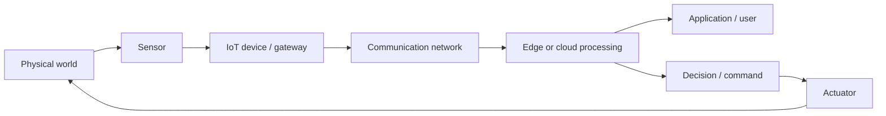
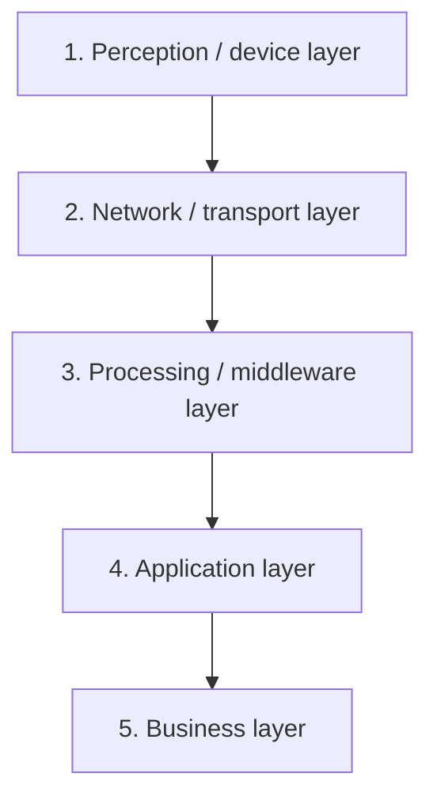
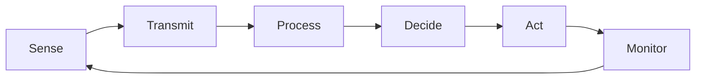
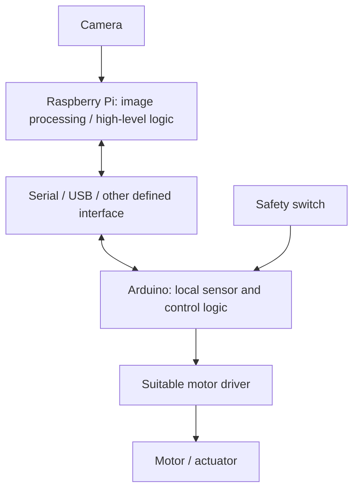

# IoT Architecture, Arduino and Raspberry Pi — Complete B.Tech CSE Exam-Oriented Notes

> **Course:** B.Tech Computer Science and Engineering
> **Subject area:** Internet of Things (IoT), Arduino, and Raspberry Pi
> **Purpose:** Conceptual learning, practical understanding, and university examination preparation
> **Scope note:** No separate formal university syllabus or marking scheme was present in the uploaded files. These notes therefore organize the topics found in the uploaded IoT lecture deck, Arduino board handout, and 20-question Arduino/Raspberry Pi question bank into logical study units. The unit names below are study sections, not claimed official university unit numbers.

## Table of Contents

1. [How to Use These Notes](#how-to-use-these-notes)
2. [Scope and Coverage Map](#scope-and-coverage-map)
3. [Unit 1: Fundamentals of the Internet of Things](#unit-1-fundamentals-of-the-internet-of-things)
4. [Unit 2: IoT Architecture and Its Five Layers](#unit-2-iot-architecture-and-its-five-layers)
5. [Unit 3: IoT Architectural Views](#unit-3-iot-architectural-views)
6. [Unit 4: State of the Art in IoT](#unit-4-state-of-the-art-in-iot)
7. [Unit 5: Sensors, Actuators, and Control](#unit-5-sensors-actuators-and-control)
8. [Unit 6: Arduino Uno R3 — Architecture, Components, and Working](#unit-6-arduino-uno-r3--architecture-components-and-working)
9. [Unit 7: Arduino Programming and Practical Circuits](#unit-7-arduino-programming-and-practical-circuits)
10. [Unit 8: Raspberry Pi and Arduino–Raspberry Pi Integration](#unit-8-raspberry-pi-and-arduino-raspberry-pi-integration)
11. [Unit 9: IoT Communication, Voltage Compatibility, Power, and Reliability](#unit-9-iot-communication-voltage-compatibility-power-and-reliability)
12. [Unit-Wise Important Definitions](#unit-wise-important-definitions)
13. [Comparison Tables and Frequently Confused Concepts](#comparison-tables-and-frequently-confused-concepts)
14. [Formula and Technical Rule Sheet](#formula-and-technical-rule-sheet)
15. [Detailed Model Answers to the 20 Supplied Questions](#detailed-model-answers-to-the-20-supplied-questions)
16. [Question-to-Topic Mapping](#question-to-topic-mapping)
17. [Additional Practice Questions with Answers](#additional-practice-questions-with-answers)
18. [Common Mistakes Across the Subject](#common-mistakes-across-the-subject)
19. [Last-Minute Revision Notes](#last-minute-revision-notes)
20. [Final Coverage Checklist](#final-coverage-checklist)
21. [Sources and Further Reading](#sources-and-further-reading)

## How to Use These Notes

- **For understanding:** Read the concept and its working principle before memorizing the definition.
- **For a 2-mark answer:** Write a precise definition and one essential point or example.
- **For a 5-mark answer:** Add the purpose, main components, working steps, and a relevant example.
- **For an 8–15-mark answer:** Use a labeled architecture or flow diagram, explain each part, trace the working sequence, and discuss applications, strengths, and limitations.
- **For practical questions:** Check wiring, voltage compatibility, common ground, pin capability, and power supply before assuming the program is wrong.
- **For the supplied questions:** Read the detailed model answers after the main notes. The relevant concepts are explained in the sections cited in the mapping table.

The uploaded lecture deck supplies the core framing and terminology. Explanatory engineering details have been added where needed to make the notes independently understandable, and technical statements have been written to distinguish the standard Arduino Uno R3 from other boards and from Raspberry Pi Pico.

## Scope and Coverage Map

| Study section | Topics covered                                                                           | Basis in supplied material                                              |
| ------------- | ---------------------------------------------------------------------------------------- | ----------------------------------------------------------------------- |
| Unit 1        | IoT definition, need, examples, data flow                                                | IoT lecture deck, pages 2–4                                            |
| Unit 2        | Five-layer architecture and layer functions                                              | IoT lecture deck, pages 5–9                                            |
| Unit 3        | Functional, information, deployment, and operational views                               | IoT lecture deck, pages 10 and 16–35                                   |
| Unit 4        | Edge computing, AIoT, 5G/6G, digital twins, TinyML, federated learning, security/privacy | IoT lecture deck, pages 12–15                                          |
| Unit 5        | Sensors, actuators, decision-making, thresholds, fault handling                          | IoT lecture deck, pages 17–20 and 30–37                               |
| Unit 6        | Arduino Uno components, pins, voltage, memory, specifications                            | Arduino handout; question bank                                          |
| Unit 7        | Sketch workflow, LED blinking, ADC, PWM, practical programming                           | Arduino handout; question bank                                          |
| Unit 8        | Raspberry Pi as an SBC, Arduino versus Pi, cooperative architecture                      | Question bank; standard technical background where the handout is brief |
| Unit 9        | Wireless modules, voltage level adaptation, motor power, offline operation               | Arduino handout; question bank; explanatory technical background        |
| Model answers | All 20 supplied questions                                                                | Uploaded question bank and pasted question list                         |

---

# Unit 1: Fundamentals of the Internet of Things

## 1.1 Meaning and Definition of IoT

**Internet of Things (IoT)** is a system of physical objects that can sense their surroundings, communicate over a network, process data, and perform actions based on that data.

In simple language, IoT connects real-world objects—such as lights, machines, vehicles, meters, and agricultural sensors—to computing and communication systems so that they can be monitored or controlled.

Examples include:

- A smart-home temperature sensor that sends measurements to an application and helps control a fan.
- A soil-moisture sensor that causes an irrigation pump to start when soil becomes too dry.
- An industrial sensor that reports vibration so that a machine fault can be detected early.
- A wearable device that records activity and sends measurements to a phone.
- A connected vehicle that exchanges status information with software services.

### Main elements of an IoT system

1. **Physical object or environment:** The thing being observed or controlled, such as a room, field, vehicle, or machine.
2. **Sensor:** Measures a physical quantity, such as temperature, light, pressure, motion, or moisture.
3. **Processing device:** A microcontroller, gateway, edge computer, or cloud server that interprets the measurement.
4. **Communication network:** Carries data and commands using a technology such as Wi-Fi, Bluetooth Low Energy (BLE), Zigbee, LoRaWAN, or a cellular network.
5. **Application or service:** Presents information to a user or manages a task.
6. **Actuator, when required:** Converts a control signal into a physical action, such as moving a motor, opening a valve, or switching a relay.

### Basic data-flow diagram



**Explanation:** A sensor observes the physical environment. The device collects and possibly filters the measurement. The network transports information to a processing location. Processing converts measurements into useful information or decisions. An application presents the result, and an actuator can change the physical environment. In a closed-loop system, the new physical condition is measured again.

## 1.2 Why IoT Architecture Is Needed

An IoT system can contain many devices, communication links, data stores, software services, and users. Architecture organizes these elements and defines how they work together.

IoT architecture is useful because it:

- **Organizes components:** It separates sensing, communication, processing, applications, and management.
- **Defines data flow:** It describes where sensor data originates and how it reaches the application or decision-maker.
- **Supports interoperability:** It helps different components exchange data using defined interfaces and protocols.
- **Supports scalability:** A well-structured system can add devices or services without redesigning every part.
- **Supports security and maintenance:** Responsibilities for authentication, updates, monitoring, and fault handling can be assigned clearly.
- **Improves performance planning:** Processing can be placed near a device or in the cloud according to latency, bandwidth, and resource needs.

Without an explicit architecture, the design may become difficult to debug, expand, secure, and maintain.

## 1.3 Basic IoT Working Process

A general process is:

**Sense → Communicate → Process → Decide → Act → Monitor**

1. **Sense:** A sensor measures a physical property.
2. **Communicate:** The measurement is passed to another device, gateway, edge node, or server.
3. **Process:** Software filters, converts, stores, compares, or analyzes the measurement.
4. **Decide:** The system selects an action using a threshold, rule, model, or user instruction.
5. **Act:** An actuator or another system performs the selected action.
6. **Monitor:** The system observes the result and repeats the cycle.

Not every IoT application needs an actuator. A monitoring-only system may simply display measurements or issue an alert.

### Worked example: Smart agriculture

Suppose a soil-moisture sensor reports a moisture level of 15% and the selected lower threshold is 25%.

- Sensor: measures 15% moisture.
- Controller: compares 15% with the 25% threshold.
- Decision: because 15% is below 25%, irrigation is required.
- Actuator: a pump driver or relay switches the water pump on.
- Feedback: the sensor continues measuring; the system later switches the pump off when the chosen stop condition is met.

The important idea is that IoT combines sensing, communication, processing, and action; it is not merely an internet connection attached to a sensor.

## 1.4 Applications of IoT

| Application area   | Example                                                      | Why IoT is useful                                                 |
| ------------------ | ------------------------------------------------------------ | ----------------------------------------------------------------- |
| Smart homes        | Automatic lights, temperature control, door alerts           | Remote monitoring and automation reduce repetitive manual work    |
| Smart cities       | Connected streetlights, traffic and environmental monitoring | Data from distributed locations can support coordinated decisions |
| Smart agriculture  | Soil-moisture monitoring and irrigation                      | Water can be supplied based on measured field conditions          |
| Smart healthcare   | Connected monitoring devices                                 | Measurements can be collected and shared with authorized services |
| Industrial IoT     | Vibration and temperature monitoring                         | Early warning can support predictive maintenance                  |
| Connected vehicles | Vehicle status and location data                             | Enables monitoring, diagnostics, and connected services           |

### Advantages

- Remote monitoring and control.
- Faster response to changing conditions.
- Automation of repeated tasks.
- Data collection over time for analysis.
- Potential reduction in wasted energy, water, or machine downtime.

### Limitations and challenges

- Devices and networks need suitable power.
- Sensors may be inaccurate, noisy, or fail.
- A network outage can interrupt remote communication.
- Poor security can expose devices or data.
- Different vendors and protocols can complicate integration.
- Cloud processing can introduce latency and dependence on external connectivity.

**Exam point:** State both the benefits and the conditions needed to obtain them. IoT does not automatically guarantee security, reliability, or energy savings; these depend on the design.

---

# Unit 2: IoT Architecture and Its Five Layers

The supplied lecture uses a **five-layer IoT architecture**. The layers are logical responsibilities; a real deployment does not necessarily place each layer on a separate physical device.

## 2.1 Five-layer architecture diagram



Data commonly moves upward from devices toward applications, while commands and configuration can move back down toward devices and actuators.

## 2.2 Layer 1: Perception / Device Layer

### Definition

The **perception layer** senses the physical environment and collects data from objects and devices.

### Components

- Sensors: temperature, humidity, light, motion, pressure, gas, soil moisture.
- Cameras and GPS receivers.
- Radio-frequency identification (RFID) tags/readers.
- Microcontrollers and embedded devices.
- Actuators: motors, fans, pumps, relays, valves, and LEDs.

### Working

A physical quantity—such as heat, light, movement, or moisture—is detected by a sensor. The sensor produces an electrical or digital signal. A controller reads the signal, often converts it to a numerical value, and prepares it for further processing or control.

### Example

In a smart irrigation system, a soil-moisture sensor is part of the perception layer. A controller reads the sensor and can command a pump, which is an actuator.

### Key point

The perception layer connects the digital system to the **physical world**. It is responsible for observing conditions and, where required, creating physical effects.

## 2.3 Layer 2: Network / Transport Layer

### Definition

The **network layer** transfers data between IoT devices, gateways, edge systems, and cloud platforms.

### Common communication options

| Technology      | Typical role in the supplied material   | Important consideration                                                                       |
| --------------- | --------------------------------------- | --------------------------------------------------------------------------------------------- |
| Bluetooth / BLE | Short-range device communication        | Useful for nearby devices and lower-power links; range and throughput depend on configuration |
| Wi-Fi           | Local network and internet access       | Often provides higher throughput but can require more power than some low-power radio options |
| Zigbee          | Short-range, low-power device networks  | Common in sensor and home-automation networks; requires compatible network components         |
| LoRaWAN         | Long-range, low-data-rate sensing       | Useful for small messages over large areas; not intended for high-rate video streams          |
| NB-IoT          | Cellular wide-area connectivity for IoT | Uses supported cellular infrastructure and operator service                                   |
| 4G / 5G         | Wide-area communication                 | Can provide broad connectivity and higher performance, depending on network availability      |

### Function of a gateway

A **gateway** connects devices or local networks to another network. It may aggregate data, translate protocols, filter messages, provide security functions, and forward traffic toward edge or cloud services.

The network layer does not necessarily decide what the data means. Its primary responsibility is moving information reliably between endpoints, subject to the chosen protocol and network conditions.

## 2.4 Layer 3: Processing / Middleware Layer

### Definition

The **processing or middleware layer** stores, processes, and analyzes data generated by IoT devices.

### Main functions

1. **Data storage:** Saves measurements for current operation or later analysis.
2. **Data processing:** Converts raw values, checks validity, filters noise, or calculates derived values.
3. **Data analytics:** Finds trends, patterns, anomalies, or relationships.
4. **Decision-making:** Applies rules or models to select an action.
5. **AI and machine learning:** Uses trained models where appropriate to classify, predict, or detect patterns.
6. **Device/data services:** Offers reusable services between connected devices and applications.

### Edge and cloud processing

- **Edge computing:** Processes information near the device or local network.
- **Cloud computing:** Uses remote computing infrastructure for larger-scale storage and processing.

A system may use both. For example, it may run a quick safety rule at the edge and upload summaries to the cloud for long-term analysis.

## 2.5 Layer 4: Application Layer

### Definition

The **application layer** provides IoT services to users or other software systems.

Examples include:

- Smart-home control screens.
- Agricultural monitoring dashboards.
- Healthcare monitoring interfaces.
- Industrial equipment dashboards.
- Smart-city traffic and environmental applications.

This layer presents data in a useful form, exposes controls, provides notifications, or implements application-specific workflows. It should not be confused with the physical sensor that generates the data.

## 2.6 Layer 5: Business Layer

### Definition

The **business layer** handles overall management, policies, business rules, performance monitoring, and high-level decisions for the IoT system.

It can answer questions such as:

- Is the system meeting its objectives?
- What operating policy should be applied?
- Which events should trigger an alert or escalation?
- How should services and performance be managed?
- What information is needed for management decisions?

### Application layer versus business layer

The application layer provides a concrete service, such as a dashboard showing field moisture. The business layer can define the irrigation policy, service-level targets, or management rules that determine how the system should be used.

## 2.7 Complete example: Smart-home IoT

A smart-home system may work as follows:

1. Temperature and motion sensors collect data at the perception layer.
2. Wi-Fi transports the readings through a router or gateway at the network layer.
3. An edge device or cloud service processes the readings and applies rules at the processing layer.
4. A mobile application displays room conditions and offers controls at the application layer.
5. System policies and performance monitoring are managed at the business layer.
6. A relay or other suitable actuator can switch a fan or light in response to a decision.

### Strengths of layered architecture

- Separates responsibilities and simplifies troubleshooting.
- Lets designers select different technologies for different needs.
- Supports modular upgrades and expansion.
- Makes data flow and component ownership easier to describe.

### Limitations

- The boundaries may be less distinct in small devices where several responsibilities run on one microcontroller.
- More layers can add design and integration complexity.
- A layered diagram alone does not guarantee correct security, real-time behavior, or reliability.

**Exam-writing suggestion:** Draw five stacked boxes and explain each layer in order: **Perception → Network → Processing → Application → Business**. Add one concrete example to make the answer stronger.

---

# Unit 3: IoT Architectural Views

A **view** explains a system from one particular perspective. The four views in the supplied lecture are functional, information, deployment, and operational. They describe the same IoT system, not four separate systems.

Memory aid: **WHAT → DATA → WHERE → HOW**.

## 3.1 Functional View — What does the system do?

### Definition

The **functional view** describes the functions performed by an IoT system and how those functions relate to one another.

### Main functions

1. **Sensing:** Collect measurements from the physical environment.
2. **Communication:** Transfer data between devices and services.
3. **Data processing:** Turn raw values into useful information.
4. **Data management:** Store, organize, retrieve, and manage data.
5. **Decision-making:** Determine which action is required.
6. **Actuation:** Convert a command into a physical action.
7. **Application/service:** Offer useful functionality to a user or another system.

### Example: Smart irrigation

The required functions are to sense soil moisture, communicate the measurement, compare it with a threshold, decide whether to water, control the pump, and allow the user to monitor the process.

The functional view focuses on **the jobs the system performs**. It does not primarily describe where the hardware is installed.

## 3.2 Information View — What happens to the data?

### Definition

The **information view** describes how data is generated, collected, transmitted, processed, stored, analyzed, and converted into information used for decisions.

### Data journey


### Data versus information versus decision

- **Data:** Raw measurements, such as 30, 32, 35, 38, and 40.
- **Information:** An interpretation, such as “temperature is increasing.”
- **Decision:** An action based on the information, such as “turn on cooling.”

A sequence of numbers is data. Once the system interprets the sequence as a rising temperature trend, it becomes useful information. A controller may then compare it with a threshold and take action.

### Important information-management concerns

- **Storage:** Local memory, an edge server, or a cloud database may store records.
- **Security:** Encryption protects data during transfer or storage; authentication checks identity; authorization checks allowed actions.
- **Filtering:** Removes or reduces unwanted noise or invalid records.
- **Aggregation:** Combines multiple measurements into a summary, such as a five-minute average.
- **Retention:** Defines how long information is kept and when it is deleted.

## 3.3 Deployment View — Where are components placed?

### Definition

The **deployment view** describes where IoT components are placed in a physical or logical environment and how they are connected.

Typical components include:

- IoT devices and sensors in the physical environment.
- Actuators near the equipment they control.
- A gateway near a group of devices.
- An edge server near the local network or site.
- A cloud server in a remote data center.
- User applications on a phone, tablet, or computer.

### Gateway, edge, and cloud: distinct roles

| Component    | Typical role                                                             | Why location matters                                                                  |
| ------------ | ------------------------------------------------------------------------ | ------------------------------------------------------------------------------------- |
| Gateway      | Connects local devices to a network; may aggregate or translate data     | It must be reachable by the devices and by the upstream network                       |
| Edge server  | Processes data near the devices                                          | Nearby processing can reduce delay and upstream traffic                               |
| Cloud server | Provides remote storage, large-scale processing, analytics, and services | It can provide scale and centralized access, but communication depends on the network |

### Example: Smart agriculture deployment

Sensors are placed across a field. A gateway is placed where it can communicate with the sensors. An edge device may be installed near the field to make local decisions. Cloud services may store long-term records, and the farmer accesses summaries through a mobile application.

The deployment view asks **where components are placed**, not what all their functions are or how the data is interpreted.

## 3.4 Operational View — How does the system behave?

### Definition

The **operational view** describes how an IoT system behaves while running, including monitoring, communication, processing, control, response, security, fault handling, and maintenance.

### Continuous operation



IoT systems often repeat this cycle continuously. The operational view includes normal operation and the response to abnormal conditions.

### Example: Smart air conditioner

Suppose the selected temperature thresholds are 25°C for activation and 24°C for deactivation in a simple example.

1. The temperature sensor measures the room.
2. The controller reads the measurement.
3. The controller compares the value with the configured condition.
4. If the temperature rises above the activation threshold, it commands cooling on.
5. Cooling continues until the deactivation condition is reached.
6. The system repeats monitoring.

A practical design often uses different activation and deactivation thresholds (hysteresis) to avoid rapid switching near one threshold. The exact values should be chosen for the intended system; this example illustrates the principle rather than a universal air-conditioner setting.

### Fault handling

An operational design should consider:

- Detecting a disconnected or failed sensor.
- Checking whether readings are outside plausible limits.
- Generating an alert when a device fails.
- Entering a safe state when essential information is unavailable.
- Recovering from errors when possible.
- Continuing critical local operation even if a remote service is unavailable, where the system is designed to support it.
- Scheduling maintenance and managing software updates.

## 3.5 Comparing the Four Views

| View        | Main question                  | Focus                                                            | Smart-irrigation example                                       |
| ----------- | ------------------------------ | ---------------------------------------------------------------- | -------------------------------------------------------------- |
| Functional  | What does the system do?       | Sensing, communication, processing, decision, actuation, service | Measures moisture and controls the pump                        |
| Information | What happens to the data?      | Data generation, movement, storage, processing, and meaning      | Moisture readings are stored and compared with a threshold     |
| Deployment  | Where are components placed?   | Physical/logical locations and connections                       | Sensors are in the field, gateway nearby, cloud remote         |
| Operational | How does it operate over time? | Repeated behavior, control, monitoring, failures, recovery       | Continuously monitors moisture and switches the pump as needed |

### Common examination trap

Do not write “functional view means functions of the components only” without describing the full set of system functions. Similarly, the deployment view is about placement, whereas the operational view is about behavior during execution.

---

# Unit 4: State of the Art in IoT

In the lecture deck, **state of the art** means the advanced technologies, methods, and research directions in a field. The important themes listed are edge computing, AIoT, 5G/6G, digital twins, TinyML, federated learning, security, and privacy.

## 4.1 Edge Computing

### Definition

**Edge computing** processes data close to the IoT device or the local point where data is produced, rather than sending every measurement to a distant cloud service for processing.

### Working

1. A sensor produces a measurement.
2. A nearby microcontroller, gateway, or edge computer receives the data.
3. The edge device performs a quick calculation or rule check.
4. It acts locally or sends a result upstream.
5. Selected readings or summaries can still be uploaded to the cloud for longer-term storage or analysis.

### Benefits

- **Low latency:** A local decision can avoid the round trip to a remote service.
- **Fast response:** Useful when the device needs timely action.
- **Lower network traffic:** The system can transmit summaries rather than every raw reading.
- **Potential privacy improvement:** Some raw data can be processed locally instead of being sent away.
- **Continued local operation:** A carefully designed edge system can keep essential functions running during internet outages.

### Limitations

- Edge devices have limited compute, memory, and storage compared with large cloud servers.
- Devices spread across many locations can be harder to update and manage.
- Local processing still needs security, monitoring, and recovery mechanisms.

**Example:** A local controller turns off a machine when a safety sensor detects a dangerous state. The cloud can receive an event record later, but it should not be the only place where the urgent safety decision is made.

## 4.2 AIoT — Artificial Intelligence of Things

**AIoT** combines Artificial Intelligence (AI) with IoT. IoT produces connected sensor data; AI methods can classify, predict, detect anomalies, or recommend decisions from that data.

```text
IoT data → AI model → prediction / classification → decision or recommendation
```

### Applications

- Smart surveillance and event detection.
- Predictive maintenance based on equipment signals.
- Healthcare monitoring support.
- Autonomous or semi-autonomous systems.
- Agricultural detection of patterns in field measurements.

### Example

A factory sensor collects vibration measurements from a motor. An AI model evaluates patterns that are associated with abnormal vibration. The system can notify maintenance staff or schedule an inspection.

### Important limitation

AI output is only as reliable as the data, model, operating conditions, and validation allow. For safety-critical control, the design must also define what happens when the model is uncertain, unavailable, or wrong.

## 4.3 5G and 6G

The supplied lecture lists 5G/6G in connection with high speed, low latency, and massive connectivity.

- **5G** is a generation of cellular networking used in mobile and connected-device applications. Performance depends on network deployment, coverage, load, device capability, and service configuration.
- **6G** is a developing research and standardization direction rather than a capability that should be assumed to exist in every deployed IoT network.

Potentially relevant goals include supporting many devices, providing high data rates, and reducing communication delay in suitable environments. Not every IoT device needs cellular broadband: a tiny battery-powered moisture sensor may be better served by a low-power local or wide-area technology.

## 4.4 Digital Twin

A **digital twin** is a virtual representation of a physical object, process, or system. It may use sensor measurements and other data to represent the state of the physical system.

### Basic relationship

```text
Physical asset ⇄ data connection ⇄ digital representation
```

### Example

A factory maintains a digital representation of a motor. Temperature, speed, and vibration data update the representation. Engineers can inspect trends, compare observed behavior with expected behavior, and investigate possible maintenance needs.

### Benefits and limitations

Benefits can include improved visibility, simulation, and maintenance planning. Limitations include the effort required to build and maintain a useful model, the quality of incoming data, and the risk of treating the model as more accurate than the evidence supports.

## 4.5 TinyML

**TinyML** refers to machine-learning models designed to run on small, resource-constrained devices, such as some microcontrollers and embedded systems.

The device may perform a small inference locally—for example, recognizing a simple sound pattern or classifying a sensor event—without continuously sending every raw sample to the cloud.

### Benefits

- Local response and potentially low latency.
- Reduced communication requirements.
- Some tasks can continue when the network is unavailable.
- Raw sensor data may remain on the device.

### Limitations

- Restricted memory, computation, and energy.
- Model size and accuracy must be balanced against device limits.
- Training commonly takes place on a more capable system, even when inference runs on the microcontroller.

## 4.6 Federated Learning

**Federated learning** is a machine-learning approach in which multiple devices or sites train locally on their own data and exchange model updates or related training information with a coordinating process, rather than automatically collecting all raw data in one central location.

It can help reduce the need to centralize raw data, but it does **not** automatically guarantee privacy or security. Model updates can still leak information, and the system needs protection against malicious or faulty participants.

## 4.7 IoT Security and Privacy

IoT security protects devices, communication, stored data, services, and control actions from unauthorized use or interference. Privacy concerns how personal or sensitive data is collected, used, shared, retained, and protected.

Important controls include:

- **Authentication:** Verify a device or user's identity.
- **Authorization:** Restrict operations to permitted identities.
- **Encryption:** Protect information against unauthorized reading while it is stored or transferred, when correctly implemented.
- **Secure updates:** Deliver and install authorized software updates.
- **Least privilege:** Give each component only the permissions it needs.
- **Network segmentation:** Limit how far a compromised device can reach.
- **Data minimization:** Collect only what is required for the intended purpose.
- **Monitoring and recovery:** Detect unusual behavior and provide a safe recovery route.

### Security design principle

Security should be considered across the full system, from sensor hardware and firmware to gateways, network communication, cloud services, and user applications. An IoT device is not secure merely because it uses Wi-Fi or encrypts one message type.

## 4.8 Summary of Modern IoT Trends

| Trend                   | Core idea                                                       | Typical value                                                        |
| ----------------------- | --------------------------------------------------------------- | -------------------------------------------------------------------- |
| Edge computing          | Process close to the source                                     | Lower delay and less upstream traffic                                |
| AIoT                    | Combine IoT data with AI                                        | Prediction, classification, and anomaly detection                    |
| 5G / research toward 6G | Advanced cellular connectivity                                  | Potentially high throughput, low latency, and many connected devices |
| Digital twin            | Virtual representation of a physical system                     | Monitoring, analysis, and simulation                                 |
| TinyML                  | Small ML inference on constrained devices                       | Local intelligent functions on small devices                         |
| Federated learning      | Train across sites without centralizing all raw data by default | Collaborative learning with reduced raw-data movement                |
| Security and privacy    | Protect devices, actions, and information                       | Trust, resilience, and appropriate data use                          |

---

# Unit 5: Sensors, Actuators, and Control

## 5.1 Sensor

A **sensor** detects or measures a physical quantity and converts it into an electrical or digital signal that a system can read.

Examples:

- Temperature sensor: temperature.
- Humidity sensor: humidity.
- Light sensor: light level.
- Motion sensor: motion or occupancy.
- Gas sensor: gas-related measurement.
- Soil-moisture sensor: soil moisture.
- Pressure sensor: pressure.
- Camera: image data.

### How a sensor fits into an IoT system

A sensor produces the measurement. The controller reads or receives it. The value may require calibration, conversion, filtering, or validation before it is used to make a decision.

A sensor reading can be wrong or unavailable because of wiring faults, noise, poor calibration, environmental limitations, power problems, or sensor failure. A robust system should not assume every reading is valid.

## 5.2 Actuator

An **actuator** receives a control command and produces a physical action. Examples include a motor, fan, pump, valve, relay, and LED.

A controller may not drive a large actuator directly. Instead, it sends a low-power control signal to a driver, relay module, or power stage that can handle the required load.

## 5.3 Sensor versus Actuator

| Basis                       | Sensor                                          | Actuator                                             |
| --------------------------- | ----------------------------------------------- | ---------------------------------------------------- |
| Main role                   | Measures or detects the physical world          | Produces a physical action                           |
| Direction in a control loop | Physical condition → signal                    | Control command → physical effect                   |
| Examples                    | Temperature, light, moisture, motion sensor     | Fan, motor, pump, valve, relay, LED                  |
| Common design concern       | Measurement range, calibration, noise, sampling | Voltage/current rating, driver, power, response time |

Memory aid: **Sensor = sense the world; actuator = act on the world.**

## 5.4 Threshold-Based Control

A basic controller compares a measured value with a set point or threshold.

For example:

- If temperature is above a limit, turn a fan on.
- If soil moisture is below a limit, turn a pump on.
- If a light level is below a limit, turn a lamp on.

A one-threshold controller can behave badly when noisy readings fluctuate just above and below the threshold. The output may switch rapidly. This is known as **chattering** or rapid switching.

## 5.5 Hysteresis

**Hysteresis** in threshold control uses different activation and deactivation thresholds. This creates a band in which the current state is maintained instead of switching at every small fluctuation.

### Example: Fan control

- Turn the fan **ON** when temperature rises above 30°C.
- Keep the fan ON while temperature falls through the 30°C-to-27°C band.
- Turn the fan **OFF** when temperature falls below 27°C.

The gap between 30°C and 27°C prevents small measurement changes around one threshold from repeatedly switching the fan.

For a moisture controller, the direction of the thresholds may be reversed because the pump is activated by low moisture. The principle remains the same: the activation and deactivation conditions differ.

### Hysteresis versus filtering

- **Hysteresis** stabilizes the decision by using different switch-on and switch-off thresholds.
- **Filtering** reduces fluctuations in the measured signal, for example by averaging several samples.

They can be used together, but they are not the same technique.

## 5.6 Local Control and Fault Handling

If an action must occur promptly—for example, stopping a mechanism when a safety switch is activated—the critical response should be handled locally and should not depend solely on slow camera processing, a remote cloud service, or internet availability.

A robust controller should consider:

1. What is the safe state if a sensor fails?
2. What happens if the network connection disappears?
3. Can the essential decision be made locally?
4. How will the system record or report a fault?
5. Does the actuator have a driver and power supply suitable for the load?
6. Can the system recover without repeating an unsafe action?

**Safety note:** The exact implementation depends on the risk level. A classroom Arduino project is not automatically an adequate certified safety controller for industrial or human-safety applications.

---

# Unit 6: Arduino Uno R3 — Architecture, Components, and Working

## 6.1 What Is Arduino?

**Arduino** is an electronics development platform commonly used for learning, prototyping, automation, robotics, and IoT. An Arduino Uno R3 is a **microcontroller board** based on the ***ATmega328P** *microcontroller.

A microcontroller integrates a processor, memory, and peripherals for dedicated embedded tasks. The Uno can read input signals, execute a stored program, and control output pins or external driver circuits.

## 6.2 Arduino Uno R3 Specifications

| Specification             | Standard Arduino Uno R3 value |
| ------------------------- | ----------------------------- |
| Main microcontroller      | ATmega328P                    |
| Operating logic voltage   | 5 V                           |
| Digital input/output pins | 14 (pins 0–13)               |
| Analog input pins         | 6 (A0–A5)                    |
| PWM-capable digital pins  | 3, 5, 6, 9, 10, 11            |
| Flash memory              | 32 KB                         |
| SRAM                      | 2 KB                          |
| EEPROM                    | 1 KB                          |
| Clock                     | 16 MHz                        |
| Common interfaces         | UART serial, SPI, I²C/TWI    |

These values refer to the **standard Uno R3**, not every board sold under the Arduino name. Other Arduino boards can use different processors, voltage levels, memory sizes, and pin arrangements.

## 6.3 Main Board Components and Their Functions

| Component                            | Function                                                                                                                           |
| ------------------------------------ | ---------------------------------------------------------------------------------------------------------------------------------- |
| ATmega328P microcontroller           | Executes the sketch and controls the board's inputs and outputs                                                                    |
| USB connector                        | Connects to a computer for uploading code and serial communication; commonly supplies board power                                  |
| Power jack                           | Accepts a suitable external power adapter                                                                                          |
| Voltage regulation / power circuitry | Helps provide the board's required supply rails within the board's operating limits                                                |
| Reset button                         | Restarts program execution                                                                                                         |
| Digital pins 0–13                   | Read or output digital states, HIGH or LOW; selected pins also have special functions                                              |
| Analog inputs A0–A5                 | Measure analog voltages using the microcontroller's ADC                                                                            |
| PWM pins                             | Generate pulse-width-modulated output for compatible uses such as dimming an LED or commanding a motor driver                      |
| RX/TX pins 0 and 1                   | Receive and transmit UART serial data; shared with the USB serial path on the standard Uno                                         |
| 5V and 3.3V pins                     | Supply the stated rail to compatible low-current external circuits or serve other board-specific power roles; check current limits |
| VIN                                  | External input to the board's regulator when used as specified; it is not a general-purpose output pin                             |
| GND                                  | Common 0 V reference and return path for the circuit                                                                               |
| ICSP header                          | In-Circuit Serial Programming interface, commonly used with an external programmer and SPI-related signals                         |
| AREF                                 | External analog-reference input when the software and board are configured for it                                                  |
| Built-in LED                         | Board LED connected to the designated pin (commonly digital pin 13 on the Uno R3)                                                  |

### Important pin distinction

- **Digital input/output:** Reads or writes a discrete logic state.
- **Analog input:** Measures a variable voltage over the allowed input range and converts it into a number.
- **PWM output:** Produces a digital pulse train with a controllable duty cycle. It is not a true, continuously variable analog-voltage output.

## 6.4 Digital Pins

A digital pin reads or outputs a logic state. In a basic 5 V Uno system, LOW is near 0 V and HIGH is near the board's logic supply, subject to the microcontroller's electrical specifications.

Common uses include reading a push button, detecting a digital sensor output, switching an LED through a suitable resistor, or sending a control signal to a driver.

The pin mode is normally configured as `INPUT`, `INPUT_PULLUP`, or `OUTPUT` using `pinMode()`.

Do not assume that a GPIO pin can directly power a motor, pump, or high-current load. Pins are signal interfaces, not general-purpose power supplies.

## 6.5 Analog Inputs and the ADC

**ADC** stands for **Analog-to-Digital Converter**. It converts a continuous input voltage into a digital number that a program can process.

The Uno's ATmega328P has a 10-bit ADC. A 10-bit converter has:

\[
2^{10}=1024
\]

possible output codes, numbered 0 through 1023.

With the default reference near 5 V, a reading of 0 is associated with ground and a reading close to 1023 with a voltage close to the upper reference. The precise conversion depends on the actual reference voltage and converter characteristics.

A useful ideal estimate is:

\[
V_{in} \approx \frac{N}{1023} V_{ref}
\]

where:

- \(V_{in}\) is the input voltage,
- \(N\) is the ADC reading from 0 to 1023,
- \(V_{ref}\) is the analog reference voltage.

**Example:** If the reference is 5.0 V and the reading is approximately 512, the measured voltage estimate is:

\[
V_{in} \approx \frac{512}{1023}\times 5.0 \approx 2.50\text{ V}
\]

This is an ideal estimate, not a guarantee of exact voltage measurement. Reference accuracy, electrical noise, sensor calibration, and component tolerances matter.

### ADC and sensor connection safety

An analog input must remain within the voltage range permitted by the board and microcontroller. A sensor that outputs up to 5 V must not be connected directly to a 3.3 V-only input unless the interface is specifically rated to tolerate it. Use a suitable divider, level-shifting/interface circuit, or sensor supply/configuration that safely limits the signal.

## 6.6 PWM — Pulse-Width Modulation

**Pulse-Width Modulation (PWM)** is a way to control the average power delivered to a load by switching a digital signal between LOW and HIGH and varying the fraction of time it stays HIGH.

**Duty cycle** is:

\[
D=\frac{T_{ON}}{T}\times 100\%
\]

where \(T_{ON}\) is the time spent HIGH in each period and \(T\) is the full period.

For an ideal 5 V PWM waveform:

- 0% duty cycle is always LOW.
- 25% duty cycle is HIGH for one-quarter of each period.
- 50% duty cycle is HIGH for half of each period.
- 100% duty cycle is always HIGH.

In many applications, the load or its driver responds to the average effect of the pulses. This allows brightness or motor speed to be controlled without using a true analog output voltage.

On the Uno R3, the six commonly documented PWM-capable pins are **3, 5, 6, 9, 10, and 11**. The Arduino API's `analogWrite()` normally accepts values from 0 to 255 on these pins. Exact PWM frequency and behavior can depend on the pin and timer configuration.

### PWM is not the same as ADC

- **ADC:** Converts an analog input voltage into a digital number.
- **PWM:** Generates a digital pulse train with a configurable duty cycle.

A light sensor may be read using `analogRead()`, while an LED's brightness may be controlled using `analogWrite()` on a PWM-capable pin.

## 6.7 Memory in the Arduino Uno R3

| Memory type | Uno R3 capacity | Volatile? | Main purpose                                                                                                        |
| ----------- | --------------: | --------- | ------------------------------------------------------------------------------------------------------------------- |
| Flash       |           32 KB | No        | Stores the compiled program and related program data; some space is used by the bootloader on common configurations |
| SRAM        |            2 KB | Yes       | Stores variables, temporary data, and the stack while the program runs                                              |
| EEPROM      |            1 KB | No        | Stores small values that must remain after power is removed                                                         |

### Flash memory

Flash is non-volatile program memory. The compiled sketch is stored there so it can run after the board restarts.

### SRAM

SRAM is working memory used during program execution. Its contents are lost when power is removed. Because the Uno has limited SRAM, large strings, arrays, buffers, or deeply nested calls can cause memory problems.

### EEPROM

EEPROM is non-volatile memory suited to small settings or values that should survive a power cycle, such as a saved counter or configuration. It is not ideal for continuously changing large datasets; writes are relatively slow and each memory location has a finite write endurance.

**Memory aid:** **Flash = program; SRAM = working data; EEPROM = small persistent data.**

## 6.8 Serial Communication Pins 0 and 1

On the standard Uno R3:

- **Pin 0 = RX**, the UART receive signal.
- **Pin 1 = TX**, the UART transmit signal.

They are associated with serial communication and are connected through the board's USB-to-serial interface. External circuitry connected to these pins may interfere with uploading a sketch or using the Serial Monitor. Disconnect or isolate such circuitry when troubleshooting upload/serial problems.

Do not confuse RX/TX with:

- **SDA/SCL:** I²C/TWI data and clock.
- **MOSI/MISO/SCK/SS:** SPI signals.
- **AREF:** Analog reference voltage pin.

## 6.9 AREF, ICSP, and Other Interfaces

- **AREF — Analog Reference:** Provides an external reference for analog input conversion when used with the supported software configuration. It is not a general-purpose analog input or power pin.
- **ICSP — In-Circuit Serial Programming:** A programming interface that allows a compatible external programmer to program the microcontroller. Its signals commonly include power, ground, reset, and SPI-related lines.
- **I²C/TWI:** On the Uno, A4 is SDA and A5 is SCL for the standard I²C/TWI interface.
- **SPI:** Uses signals commonly mapped to digital pins 10–13 on the Uno, with the exact role of each pin determined by the SPI interface.

## 6.10 Standard Arduino Program Structure

A typical Arduino sketch contains two essential functions:

```cpp
void setup() {
  // Runs once after reset or power-up.
}

void loop() {
  // Runs repeatedly while the board is operating.
}
```

- `setup()` initializes pin modes, serial communication, and other required state.
- `loop()` contains the repeatedly executed program logic.

### Arduino working process

**Write → Compile → Upload → Execute → Read inputs → Process data → Produce outputs → Repeat**

1. Write a sketch in the Arduino IDE or a compatible tool.
2. Connect the board to a computer and select the correct board/port.
3. Compile the sketch to check syntax and build the program.
4. Upload the compiled program to the microcontroller.
5. The program starts, usually executing `setup()` first.
6. The repeated `loop()` reads sensors, evaluates conditions, and updates outputs.

### Applications of Arduino

- Learning electronics and embedded programming.
- Reading sensors and controlling LEDs, buzzers, relays, or motor drivers.
- Robotics and drone prototypes.
- Smart-home experiments.
- Irrigation and environmental monitoring.
- Small IoT devices, often with an additional communication module.

### Advantages

- Accessible hardware and tools.
- Useful digital inputs/outputs and analog inputs.
- Fast startup for small control tasks.
- Large learning ecosystem and many example programs.

### Limitations

- Limited program memory and SRAM compared with a computer.
- Standard Uno R3 does not provide built-in Wi-Fi.
- No general-purpose desktop operating system on the Uno.
- GPIO current and voltage limits mean external drivers and power stages are required for many loads.
- Timing is not equivalent to a certified hard-real-time safety platform.

---

# Unit 7: Arduino Programming and Practical Circuits

## 7.1 Example 1 — LED Blinking

### Aim

To repeatedly turn an LED on and off using an Arduino Uno.

### Components

- Arduino Uno R3.
- LED.
- 220 Ω current-limiting resistor (a suitable value can vary with the LED and desired current).
- Breadboard and jumper wires, if using an external LED.
- USB cable or suitable power source.

### Connection

Connect a PWM-capable or ordinary digital output pin—pin 13 is convenient for the Uno's built-in LED—to the LED circuit. For an external LED, use a series resistor and correct polarity. Connect the return to GND. Do not connect the LED directly across a supply without current limiting.

### Program

```cpp
const int ledPin = 13;

void setup() {
  pinMode(ledPin, OUTPUT);
}

void loop() {
  digitalWrite(ledPin, HIGH);  // Turn LED on
  delay(1000);                 // Wait 1 second
  digitalWrite(ledPin, LOW);   // Turn LED off
  delay(1000);                 // Wait 1 second
}
```

### Explanation

1. `ledPin` names the pin used for the LED.
2. `pinMode(..., OUTPUT)` configures it as an output.
3. `digitalWrite(..., HIGH)` sets the output HIGH and lights the correctly connected LED.
4. `delay(1000)` pauses for approximately 1000 milliseconds.
5. LOW turns the LED off.
6. Since `loop()` repeats, the sequence continues until power is removed or the program is reset.

### Observation

The LED remains on for approximately one second and off for approximately one second, repeating continuously.

## 7.2 Example 2 — Read a Light Sensor and Control LED Brightness with PWM

### Aim

Read a variable analog value and map it to a PWM duty command for an LED.

### Principle

- `analogRead(A0)` reads the sensor signal through the ADC and, on the standard Uno, returns a value from 0 to 1023.
- `analogWrite(pwmPin, value)` sets the PWM output command from 0 to 255 on a supported PWM pin.
- `map()` can scale one numerical range to another, but it does not clamp out-of-range values automatically in every use case; validate values when necessary.

### Program

```cpp
const int sensorPin = A0;
const int ledPin = 9;  // PWM-capable Uno pin

void setup() {
  pinMode(ledPin, OUTPUT);
  Serial.begin(9600);
}

void loop() {
  int sensorValue = analogRead(sensorPin);       // 0 to 1023
  int pwmValue = map(sensorValue, 0, 1023, 0, 255);
  analogWrite(ledPin, pwmValue);                 // PWM duty command

  Serial.print("Sensor: ");
  Serial.print(sensorValue);
  Serial.print("  PWM: ");
  Serial.println(pwmValue);
  delay(50);
}
```

### How to reason about the program

1. The sensor value is read correctly from A0.
2. The sensor range 0–1023 is mapped to 0–255.
3. The mapped value is written to pin 9 using PWM.
4. If the reading changes but brightness does not, investigate the output pin, LED circuit, wiring, polarity, resistor, output connection, and the load/driver—not the EEPROM or number of analog pins.

The mapping direction can be reversed if the desired physical response is opposite. For example, a light-dependent resistor circuit may produce a higher ADC reading in darkness or in bright light depending on how the voltage divider is wired.

## 7.3 Example 3 — Threshold Control with Hysteresis

The following example shows a temperature-like input represented by an analog sensor reading. Replace the simple conversion with the correct conversion for the actual sensor used.

```cpp
const int sensorPin = A0;
const int fanControlPin = 8;  // Signal to a suitable driver, not the fan itself
bool fanOn = false;

void setup() {
  pinMode(fanControlPin, OUTPUT);
  digitalWrite(fanControlPin, LOW);
  Serial.begin(9600);
}

void loop() {
  int raw = analogRead(sensorPin);

  // Example only: use a sensor-specific conversion to obtain temperature.
  float temperatureC = convertSensorToCelsius(raw);

  if (!fanOn && temperatureC >= 30.0) {
    fanOn = true;
  } else if (fanOn && temperatureC <= 27.0) {
    fanOn = false;
  }

  digitalWrite(fanControlPin, fanOn ? HIGH : LOW);
  delay(100);
}
```

`convertSensorToCelsius()` is a placeholder function and must be implemented for the actual sensor. This code is a logic illustration, not a complete upload-ready sketch until the conversion function and circuit are supplied. The on/off thresholds differ by 3°C, which implements hysteresis.

## 7.4 Program-Writing and Troubleshooting Checklist

Before running a sketch:

1. Confirm the selected board is Uno R3 and the correct port is selected.
2. Check the wiring against the pin numbers in the sketch.
3. Confirm output pins are configured as outputs and input pins as inputs.
4. Check whether an output requires a PWM-capable pin.
5. Verify the sensor's output-voltage range is safe for the board.
6. Use a suitable resistor for an LED and a driver for motors, fans, pumps, or other loads.
7. Ensure the Arduino and external circuit share a ground when required by the signal interface.
8. Check for supply voltage drop or reset when a high-current load starts.
9. Use Serial Monitor diagnostics where useful.
10. Do not change the algorithm before checking basic electrical causes.

---

# Unit 8: Raspberry Pi and Arduino–Raspberry Pi Integration

The uploaded question bank asks for the architectural difference between an Arduino Uno and a Raspberry Pi, and describes a design in which the Pi performs image recognition while the Arduino handles sensors, motors, and a safety input. The following background makes those questions understandable.

## 8.1 What Is a Raspberry Pi?

A **classic Raspberry Pi single-board computer (SBC)** is a compact computer that can run a general-purpose operating system, commonly a Linux-based operating system. It typically includes a processor, RAM, network and peripheral interfaces, and storage support such as a microSD card slot. It can run multi-process programs, software libraries, networking services, databases, and image-processing workloads.

**Important qualification:** Raspberry Pi is a product family. Raspberry Pi Pico boards are microcontroller boards and do not run Linux in the same way as classic Raspberry Pi SBCs. For the question-bank comparison, “Raspberry Pi” means a classic Raspberry Pi computer unless the model is specified otherwise.

## 8.2 Arduino Uno versus Raspberry Pi SBC

| Basis                 | Arduino Uno R3                                                                                                   | Classic Raspberry Pi SBC                                                                                 |
| --------------------- | ---------------------------------------------------------------------------------------------------------------- | -------------------------------------------------------------------------------------------------------- |
| Main architecture     | Microcontroller development board                                                                                | Single-board computer                                                                                    |
| Typical execution     | A compiled sketch running directly on the microcontroller                                                        | Programs run under a general-purpose operating system                                                    |
| Operating system      | No general-purpose Linux OS on the Uno                                                                           | Commonly runs a Linux-based OS                                                                           |
| Main memory           | Small on-chip Flash/SRAM/EEPROM capacities                                                                       | Typically much more RAM and non-volatile storage through boot media; exact amounts vary by model         |
| Startup               | Usually starts the sketch quickly after reset                                                                    | Must initialize hardware and boot the operating system and services                                      |
| Best-suited workloads | Small embedded control, repeated I/O, simple local control loops                                                 | Image processing, application software, network services, databases, and higher-level computing          |
| Timing                | Can provide predictable timing for simple loops when designed carefully, though not a certified safety guarantee | General-purpose OS scheduling can introduce timing variability                                           |
| GPIO                  | 5 V logic on the standard Uno R3                                                                                 | GPIO is 3.3 V logic on common classic models; never assume 5 V tolerance                                 |
| Storage               | Flash for program, SRAM for runtime data, EEPROM for small persistent values                                     | Boot/storage media such as microSD on many models, plus RAM and other model-dependent storage interfaces |
| Typical project role  | Read sensors and issue control signals                                                                           | Run complex applications, networking, camera processing, or AI libraries                                 |

### Core distinction

The Uno is a **microcontroller board** designed for embedded control. A classic Raspberry Pi is a **single-board computer** designed to run a full operating system and general-purpose applications. They are complementary, not interchangeable in every task.

## 8.3 Why Combine Them?

A Raspberry Pi can perform computationally intensive work, such as image recognition, while an Arduino can handle direct sensor reads and actuator commands. This divides the work by the strengths of each device.

### Example architecture: Camera plus safety switch



### Why the separation is useful

- The Pi can run complex image libraries and high-level software.
- The Arduino can read pins and control outputs without waiting for the camera-processing program to finish.
- The interface can carry summarized results or commands between the devices.
- Essential safety behavior can remain local rather than depending entirely on image processing, a remote cloud service, or a network connection.

### Design requirements

1. Define which device owns each decision.
2. Specify the communication protocol and message format.
3. Validate commands received from the Pi.
4. Decide what the Arduino does if communication is lost.
5. Keep critical safety responses local and independent of slow processing.
6. Ensure voltage levels are compatible between the devices.
7. Use correct drivers and power supplies for motors and other loads.
8. Test failure conditions, including reboot, disconnection, malformed messages, and power interruption.

## 8.4 Communication Between Arduino and Raspberry Pi

Possible interfaces include USB serial or a suitable UART interface. The choice depends on the particular Pi, Arduino, wiring, required data rate, electrical levels, and software.

When using UART signals, transmit and receive lines must be connected appropriately (TX to RX and RX to TX) and the devices must share a suitable ground reference. A voltage-level interface may be required: the Uno R3 uses 5 V logic while common Raspberry Pi GPIO uses 3.3 V logic. Do not connect a 5 V Arduino output directly to a Pi GPIO input unless a suitable protected, level-compatible interface is used.

For robust communication, specify message boundaries, data types, valid ranges, error handling, and a timeout behavior. A controller should not keep executing an unsafe old command indefinitely just because a new command stopped arriving.

---

# Unit 9: IoT Communication, Voltage Compatibility, Power, and Reliability

## 9.1 ESP8266 and ESP32

The Arduino handout names the ESP8266 and ESP32 as common wireless options.

- **ESP8266:** A Wi-Fi-capable device family widely used in small connected projects. NodeMCU development boards are common ESP8266-based development platforms; ESP-01 is a compact ESP8266 module.
- **ESP32:** A family of devices with Wi-Fi and, on many variants, Bluetooth support. Exact radio and peripheral features differ by variant.
- **HC-05:** A module commonly used for Bluetooth Classic serial communication, particularly in simple educational projects.

These are not all the same kind of item: ESP8266/ESP32 refer to device or chip families, while NodeMCU is a development-board platform name commonly associated with ESP modules, and HC-05 is a Bluetooth serial module.

### Selecting a communication option

Consider range, data rate, power consumption, network infrastructure, cost, protocol support, security, compatibility, and whether communication must continue during an internet outage. A system does not necessarily need internet access to use a local wireless network.

## 9.2 Voltage Levels and Level Shifting

A logic-level mismatch occurs when one device produces a voltage that another device cannot safely accept.

For example, a sensor with a 0–5 V output may exceed the maximum input voltage of a 3.3 V controller. Connecting it directly can cause incorrect readings or damage.

A suitable **voltage divider** can scale an analog voltage downward. A dedicated **level shifter** or buffer can be preferable for digital signals or interfaces that require bidirectional behavior, fast edges, or better electrical characteristics.

### Voltage-divider formula

For two resistors in series, with `R1` between the input and the output node and `R2` between the output node and ground:

\[
V_{out}=V_{in}\frac{R_2}{R_1+R_2}
\]

**Example:** To scale 5 V to approximately 3.0 V, choose a ratio where \(R_2/(R_1+R_2)=0.6\). For example, R1 = 4 kΩ and R2 = 6 kΩ gives an ideal 3.0 V output at 5 V input, before tolerances and loading are considered.

This example demonstrates the ratio only. Real designs must check resistor tolerance, the input impedance and sampling behavior of the receiving circuit, current, response speed, protection, and the receiving device's absolute maximum ratings. A resistor divider should not be blindly used for every digital bus or bidirectional interface.

## 9.3 Motor Power and Unexpected Arduino Resets

A motor can draw a large starting or stall current. When it starts, the current demand may cause the supply voltage to dip. If the Arduino's supply voltage falls too low, its reset or brown-out behavior may restart the program. Electrical noise from a motor can also disturb the controller.

### First things to investigate

- Whether the power supply can provide the motor's starting and operating current.
- Whether the motor and Arduino share a supply in a way that causes voltage sag.
- Whether a suitable motor driver is used.
- Whether power and ground wiring are sufficiently low-resistance and correctly connected.
- Whether the design includes appropriate suppression and decoupling for the motor and driver.
- Whether the grounds are connected correctly for the control signal.
- Whether the battery is depleted or the regulator is overheating or overloaded.

### Good practice

- Do not power a motor directly from an Arduino GPIO pin.
- Use a driver designed for the motor's voltage and current.
- Size the supply for startup/stall current, not just average current.
- Use appropriate flyback protection for inductive loads where required by the driver topology.
- Keep high-current motor paths from disturbing sensitive logic-supply paths.
- Verify voltage at the board during motor startup, not only with no load.

If the software changes the desired speed but the physical motor responds poorly, inspect the driver, battery/supply, wiring, motor limits, and PWM signal first. The command value does not guarantee that the motor has the power or hardware needed to follow it.

## 9.4 Offline-First Operation and Store-and-Forward Synchronization

A networked system should distinguish between **local control**, **remote monitoring**, and **data synchronization**.

An offline-capable system can keep its essential local behavior running when internet access fails. It can store selected records locally and synchronize them after connectivity returns. This pattern is often called **store-and-forward**; when the design explicitly treats local operation as the default and tolerates temporary disconnection, it is also described as **offline-first**.

### Example

A wireless sensor network records measurements locally while the internet is down. When the connection returns, it uploads queued records and reconciles them with the central store.

### Design issues

- Local storage capacity and behavior when storage fills.
- Record timestamps and clock drift.
- Unique record identifiers to help avoid duplicate processing.
- Retry rules and backoff to avoid excessive network traffic.
- Handling partial uploads and repeated delivery.
- Conflict resolution if data can be changed in more than one place.
- Security for stored data and later transfer.
- A clear statement of which decisions must continue locally and which can wait for the cloud.

**Important distinction:** Offline-first/store-and-forward is a system capability or design pattern. Edge computing may help implement it, but the terms are not exact synonyms.

---

# Unit-Wise Important Definitions

1. **Internet of Things (IoT):** A system of physical objects able to sense, communicate, process data, and perform actions through connected devices and networks.
2. **IoT architecture:** A structured organization of IoT components, responsibilities, interfaces, and data flows.
3. **Perception layer:** The layer that interacts with the physical environment and collects data through sensors and devices.
4. **Network/transport layer:** The layer responsible for carrying data between devices, gateways, processing systems, and services.
5. **Processing/middleware layer:** The layer that stores, processes, analyzes, and helps make decisions from IoT data.
6. **Application layer:** The layer that provides IoT services to users or other software systems.
7. **Business layer:** The layer that manages high-level rules, policies, performance, and overall system decisions.
8. **Functional view:** A view describing what functions an IoT system performs.
9. **Information view:** A view describing how data is generated, transmitted, processed, stored, and interpreted.
10. **Deployment view:** A view describing the physical or logical placement and connection of components.
11. **Operational view:** A view describing system behavior during execution, including monitoring and fault handling.
12. **Edge computing:** Processing data near the devices or data source rather than sending all processing to a distant cloud.
13. **AIoT:** The combination of artificial intelligence methods and Internet of Things devices/data.
14. **Digital twin:** A virtual representation of a physical object, process, or system, updated or informed by relevant data.
15. **TinyML:** Machine-learning inference designed for small, resource-constrained devices.
16. **Federated learning:** A learning approach that coordinates training across multiple participants without necessarily centralizing all raw training data.
17. **Sensor:** A component that measures a physical quantity and produces an electrical or digital signal.
18. **Actuator:** A component that receives a command and causes a physical action.
19. **ADC:** Analog-to-Digital Converter; a circuit that converts an analog input into a digital code.
20. **PWM:** Pulse-Width Modulation; control of a periodic digital signal's duty cycle to influence average power or a connected system's response.
21. **Duty cycle:** The percentage of a waveform period during which the signal is in its active state.
22. **Flash memory:** Non-volatile memory used to store the compiled program on the standard Uno R3.
23. **SRAM:** Volatile working memory used for runtime variables, temporary data, and stack.
24. **EEPROM:** Non-volatile memory suitable for small values that must persist when power is removed.
25. **ICSP:** In-Circuit Serial Programming; an interface for programming a microcontroller using a compatible programmer.
26. **AREF:** Analog reference pin used when configuring the analog input reference appropriately.
27. **Hysteresis:** Control behavior that uses different activation and deactivation thresholds to prevent rapid switching.
28. **Gateway:** A component connecting local devices/networks to another network and sometimes translating or aggregating data.
29. **Raspberry Pi SBC:** A classic Raspberry Pi single-board computer capable of running a general-purpose operating system.
30. **Store-and-forward:** A communication/data-transfer pattern in which records are saved locally and forwarded when a connection becomes available.
31. **Offline-first design:** A design that preserves intended local functionality during disconnection and synchronizes with remote systems when possible.

---

# Comparison Tables and Frequently Confused Concepts

## 1. Arduino Uno and Raspberry Pi

See [Unit 8](#unit-8-raspberry-pi-and-arduino-raspberry-pi-integration). Remember that Arduino Uno R3 is a microcontroller board, while a classic Raspberry Pi is an SBC. Raspberry Pi Pico is a separate microcontroller product line.

## 2. Flash, SRAM, and EEPROM

| Basis                      | Flash                                 | SRAM                              | EEPROM                                                        |
| -------------------------- | ------------------------------------- | --------------------------------- | ------------------------------------------------------------- |
| Contents                   | Program code and related program data | Runtime data, variables, stack    | Small settings and persistent values                          |
| Retains data without power | Yes                                   | No                                | Yes                                                           |
| Main reason to use it      | Keep the program stored               | Fast working memory while running | Save selected values across power cycles                      |
| Uno R3 capacity            | 32 KB                                 | 2 KB                              | 1 KB                                                          |
| Frequent-write suitability | Not ordinary runtime storage          | Not persistent                    | Limited by write endurance; avoid unnecessary repeated writes |

## 3. ADC and PWM

| Basis                | ADC                                        | PWM                                                                        |
| -------------------- | ------------------------------------------ | -------------------------------------------------------------------------- |
| Direction            | Analog input → digital number             | Digital pulse output with a controlled duty cycle                          |
| Uno use              | `analogRead()` on analog inputs          | `analogWrite()` on PWM-capable pins                                      |
| Example              | Read a light sensor                        | Adjust LED brightness using an appropriate circuit                         |
| Important limitation | Input voltage must be within allowed range | Does not create a true DAC output; some loads require drivers or filtering |

## 4. Digital I/O and Analog Input

| Basis                   | Digital I/O                        | Analog input                             |
| ----------------------- | ---------------------------------- | ---------------------------------------- |
| Information represented | Logic state, HIGH or LOW           | Voltage converted to a number by the ADC |
| Typical examples        | Push button, digital sensor signal | Analog light or potentiometer reading    |
| Uno pins                | Digital pins 0–13                 | A0–A5                                   |

## 5. Functional View and Operational View

| Functional view                                    | Operational view                                                    |
| -------------------------------------------------- | ------------------------------------------------------------------- |
| Describes what functions exist and how they relate | Describes how the system behaves while operating over time          |
| Example: sensing, processing, decision, actuation  | Example: monitor, switch on, keep monitoring, detect fault, recover |

## 6. Information View and Deployment View

| Information view                                                  | Deployment view                                              |
| ----------------------------------------------------------------- | ------------------------------------------------------------ |
| Follows the data and its transformation                           | Follows component placement and connections                  |
| Example: sensor data is generated, filtered, stored, and analyzed | Example: sensor is in a field, gateway near it, cloud remote |

## 7. Gateway, Edge, and Cloud

| Gateway                                                      | Edge                                      | Cloud                                              |
| ------------------------------------------------------------ | ----------------------------------------- | -------------------------------------------------- |
| Connects local devices to a network; may aggregate/translate | Processes close to devices                | Provides remote large-scale storage and processing |
| Main focus: connectivity and coordination                    | Main focus: local processing and response | Main focus: centralized scale and services         |

## 8. Hysteresis and Filtering

| Hysteresis                                               | Filtering                                         |
| -------------------------------------------------------- | ------------------------------------------------- |
| Uses different on/off thresholds to stabilize a decision | Smooths or reduces fluctuation in measured values |
| Example: fan on at 30°C, off at 27°C                   | Example: average several temperature samples      |

## 9. Local Control and Cloud Control

A local controller can make essential decisions without internet service. A cloud service is useful for long-term analytics, remote access, and centralized coordination. A robust system separates functions that must work immediately from functions that can tolerate delay or disconnection.

---

# Formula and Technical Rule Sheet

## 1. ADC resolution

For an \(n\)-bit ADC:

\[
\text{Number of output codes}=2^n
\]

For the Uno's 10-bit ADC:

\[
2^{10}=1024\text{ codes, numbered }0\text{ to }1023
\]

An ideal approximate voltage calculation is:

\[
V_{in}\approx \frac{N}{1023}V_{ref}
\]

Example: \(N=512\), \(V_{ref}=5\text{ V}\) gives about \(2.50\text{ V}\).

## 2. PWM duty cycle

\[
D=\frac{T_{ON}}{T}\times100\%
\]

If a signal is HIGH for 2 ms and its full period is 10 ms, the duty cycle is \(2/10\times100\%=20\%\).

## 3. Ideal voltage divider

\[
V_{out}=V_{in}\frac{R_2}{R_1+R_2}
\]

The formula assumes the common arrangement where R1 connects input to output and R2 connects output to ground, and the load does not significantly alter the divider.

## 4. Useful Arduino Uno R3 facts to memorize

- Main microcontroller: ATmega328P.
- Logic/operating voltage: 5 V.
- Digital I/O: 14 pins, 0–13.
- Analog inputs: 6 pins, A0–A5.
- PWM pins: 3, 5, 6, 9, 10, 11.
- Flash: 32 KB; SRAM: 2 KB; EEPROM: 1 KB.
- RX = pin 0; TX = pin 1.
- I²C/TWI: A4 = SDA, A5 = SCL.
- ICSP = In-Circuit Serial Programming.
- AREF = Analog Reference.
- `analogRead()` on the standard Uno returns a 10-bit reading from 0 to 1023.
- `analogWrite()` on PWM-capable pins commonly takes values from 0 to 255.

## 5. Rules to apply before changing code

1. Never feed an input a voltage above its permitted limit.
2. Do not power motors directly from microcontroller GPIO pins.
3. Check the PWM capability of the selected pin if PWM behavior is required.
4. Provide a common ground when required by the signal interface.
5. Investigate supply sag and motor startup current when the board resets at motor startup.
6. Keep critical safety responses local and independent of slow image/cloud processing.
7. Use hysteresis to reduce threshold chatter when different activation and deactivation thresholds are appropriate.
8. Use non-volatile memory such as EEPROM only for data that needs to persist; avoid unnecessary writes.

---

# Detailed Model Answers to the 20 Supplied Questions

The answers below follow the wording of the uploaded question bank. Brief “why” explanations are included so the answer can be remembered through understanding rather than rote memorization.

## Question 1

**Question:** Which Arduino feature is primarily used to control LED brightness and motor speed?

**Correct answer: PWM (Pulse-Width Modulation).**

**Explanation:** PWM controls the duty cycle of a digital pulse train. By changing the duty cycle, a controller can influence the average power delivered to a suitable load or motor driver. On the standard Uno R3, PWM-capable pins are 3, 5, 6, 9, 10, and 11.

## Question 2

**Question:** The microcontroller used in the standard Arduino Uno R3 is the ________.

**Correct answer: ATmega328P.**

**Explanation:** The ATmega328P executes the uploaded sketch and provides digital I/O, the ADC, timers, serial interfaces, Flash, SRAM, and EEPROM used by the Uno R3.

## Question 3

**Question:** Which memory retains stored data even after power is removed and is suitable for permanent data storage? Options: SRAM, Cache, EEPROM, Register.

**Correct answer: EEPROM.**

**Explanation:** EEPROM is non-volatile and is appropriate for small values that must survive a power cycle. SRAM is volatile working memory. “Permanent” in this context means retained without power, not unlimited lifetime or immunity from write-endurance limits.

## Question 4

**Question:** What is the process or component used to convert an analog voltage into a digital value called?

**Correct answer: Analog-to-Digital Conversion, performed by an Analog-to-Digital Converter (ADC).**

**Explanation:** On the standard Uno R3, the built-in 10-bit ADC converts an analog input to a reading from 0 to 1023 over the configured reference range.

## Question 5

**Question:** On the standard Arduino Uno, digital pins 0 and 1 are associated with which serial communication signals? Options include SDA/SCL, RX/TX, MOSI/MISO, AREF/GND.

**Correct answer: RX and TX.**

**Explanation:** Pin 0 is RX (receive) and pin 1 is TX (transmit) for UART serial communication. SDA/SCL are I²C/TWI signals, while MOSI/MISO are SPI signals.

## Question 6

**Question:** The standard operating logic voltage of the Arduino Uno R3 is ________ volts.

**Correct answer: 5 V.**

**Explanation:** The standard Uno R3 uses 5 V logic. Do not confuse its logic voltage with the input voltage that can be applied to its external power jack or VIN, and do not assume another Arduino board uses the same logic level.

## Question 7

**Question:** What is the main architectural difference between Arduino Uno and Raspberry Pi?

**Correct answer: Arduino Uno is a microcontroller board, while a classic Raspberry Pi is a single-board computer.**

**Explanation:** The Uno is designed for embedded I/O control using a sketch. A classic Raspberry Pi SBC can run a general-purpose operating system and applications such as image processing. Raspberry Pi Pico is a separate microcontroller family, so the exact Raspberry Pi model matters.

## Question 8

**Question:** What is the abbreviation of the programming header used for external programming of an Arduino board?

**Correct answer: ICSP — In-Circuit Serial Programming.**

**Explanation:** The ICSP header provides a programming interface for a compatible external programmer. On the Uno R3 it is associated with programming and SPI-related signals.

## Question 9

**Question:** Which memory stores the program code on a standard Arduino Uno? Options: SRAM, Flash, Cache, Register.

**Correct answer: Flash memory.**

**Explanation:** Flash is non-volatile and retains the compiled program when power is removed. SRAM holds runtime variables and the stack; EEPROM is used for small persistent values.

## Question 10

**Question:** Name either of the two popular ESP modules commonly used to add Wi-Fi connectivity to IoT projects.

**Correct answers: ESP8266 or ESP32.**

**Explanation:** Both are popular for connected projects. ESP8266 is Wi-Fi-capable; ESP32 variants commonly include Wi-Fi and Bluetooth. Exact capability depends on the variant or development board.

## Question 11

**Question:** An Arduino reads a light sensor and controls an LED using PWM. The sensor reading changes correctly, but LED brightness does not change. Which is the most appropriate first check?

A. Check whether the LED control pin supports PWM.
B. Replace the EEPROM.
C. Increase the number of analog pins.
D. Install Linux on the Arduino.

**Correct answer: A. Check whether the LED control pin supports PWM.**

**Explanation:** The input is already changing, so the first check should focus on the PWM output path. Also verify that the sketch writes the PWM value to the same pin used by the circuit and that the LED, resistor, polarity, and ground are correct. The EEPROM and operating system are unrelated to basic PWM output.

## Question 12

**Question:** A sensor produces 0–5 V, but the controller accepts a maximum of 3.3 V. Before connecting the sensor directly, a suitable voltage ________ circuit may be required.

**Correct answer: Divider (voltage-divider) circuit.**

**Explanation:** A resistor divider can scale a suitable analog voltage downward. Depending on the signal and interface, a dedicated level shifter or buffer may be more appropriate. A 5 V output should not be connected directly to a 3.3 V-only input unless that input is explicitly rated to tolerate it.

## Question 13

**Question:** A smart door lock must continue making a local locking decision even if Wi-Fi goes down. Which design is best?

A. Put all decision-making in a cloud server.
B. Use a local microcontroller for the essential locking logic.
C. Disable the sensors when Wi-Fi fails.
D. Use Bluetooth as the only source of power.

**Correct answer: B. Use a local microcontroller for the essential locking logic.**

**Explanation:** The essential decision should not depend entirely on internet availability. The device can still use remote connectivity for notifications and management, but local sensing and critical control should be designed to work without Wi-Fi where required. Security requirements for an actual lock must be addressed carefully.

## Question 14

**Question:** An Arduino repeatedly restarts whenever a motor starts. What electrical supply problem should be investigated first?

**Correct answer: A supply-voltage dip or brownout caused by motor startup/stall current, or supply noise/overload.**

**Explanation:** A motor can demand high current at startup. If the supply or regulator cannot provide it, the voltage can drop enough to reset the microcontroller. Check supply capacity, voltage at the board during startup, wiring, grounding, the motor driver, and suitable suppression/decoupling.

## Question 15

**Question:** Raspberry Pi performs image recognition while an Arduino reads sensors and controls motors in real time. What is the main advantage of this division of work?

A. The Arduino gains unlimited RAM.
B. The Raspberry Pi no longer needs an operating system.
C. Computationally intensive processing and hardware control are separated.
D. Both devices become the same type of processor.

**Correct answer: C. Computationally intensive processing and hardware control are separated.**

**Explanation:** The Pi can run image-processing software while the Arduino handles direct I/O and local control. Separating the roles can improve design clarity and keep time-sensitive control from depending entirely on a complex vision task.

## Question 16

**Question:** An Arduino must remember a counter value after being switched off. The value is small and updated occasionally. A suitable non-volatile memory on the Uno is ________.

**Correct answer: EEPROM.**

**Explanation:** EEPROM retains data without power and is suitable for small values. Because EEPROM has finite write endurance, do not write the counter on every fast loop iteration; save it when needed or when the value changes under a suitable policy.

## Question 17

**Question:** A drone's motor speed command changes, but the motor responds slowly and inconsistently. Which investigation is most useful before changing the algorithm?

A. Check motor-driver capability, battery voltage, and PWM configuration.
B. Increase the Raspberry Pi's screen resolution.
C. Erase the Arduino's EEPROM.
D. Change the sensor's analog pin into a power pin.

**Correct answer: A. Check motor-driver capability, battery voltage, and PWM configuration.**

**Explanation:** The motor may not be receiving enough current or the intended PWM command. Check the motor driver, supply/battery under load, wiring, control-pin selection, PWM behavior, and mechanical load before assuming the algorithm is responsible.

## Question 18

**Question:** A sensor gives a noisy analog reading, causing a fan to switch on and off rapidly near a threshold. What control technique uses different activation and deactivation thresholds to reduce this behavior?

**Correct answer: Hysteresis.**

**Explanation:** Hysteresis uses separate switch-on and switch-off thresholds. For example, turn the fan on above 30°C and turn it off below 27°C. Small fluctuations between those values do not repeatedly toggle the fan. Filtering can also reduce measurement noise, but it is a different technique.

## Question 19

**Question:** A Raspberry Pi must process camera frames, while an Arduino must react immediately to a safety switch. Which is the safest design principle?

A. Make the safety response depend entirely on the camera-processing program.
B. Handle the critical safety response locally and independently of slow image processing.
C. Send every safety decision to a remote cloud service.
D. Store the safety switch state only in EEPROM.

**Correct answer: B. Handle the critical safety response locally and independently of slow image processing.**

**Explanation:** Critical safety response should not wait for image processing or remote communication. The local implementation must be appropriate for the actual risk; a basic Arduino prototype is not automatically a certified safety system.

## Question 20

**Question:** A wireless sensor network must keep working locally when internet access fails and synchronize its records after connectivity returns. What capability describes this design?

**Correct answer: Offline-first/local autonomous operation with local buffering and store-and-forward synchronization.**

**Explanation:** The devices continue their required local work during the outage, store records locally, and forward or synchronize those records when the connection returns. Edge computing may support this design, but the specific capability described is offline operation plus store-and-forward synchronization.

---

# Question-to-Topic Mapping

The questions below are the 20 questions supplied in the uploaded “Arduino & Raspberry Pi” question bank and repeated in the pasted Markdown.

| Question No. | Question / topic                                             | Relevant study unit | Concepts required                                 | Notes section | Model answer included? |
| -----------: | ------------------------------------------------------------ | ------------------- | ------------------------------------------------- | ------------- | ---------------------- |
|            1 | Feature used to control LED brightness and motor speed       | Unit 6–7           | PWM and duty cycle                                | 6.6, 7.2      | Yes                    |
|            2 | Uno R3 microcontroller                                       | Unit 6              | ATmega328P                                        | 6.2, 6.3      | Yes                    |
|            3 | Memory that retains data without power                       | Unit 6              | Non-volatile memory, EEPROM                       | 6.7           | Yes                    |
|            4 | Convert analog voltage to digital value                      | Unit 6              | ADC, resolution                                   | 6.5           | Yes                    |
|            5 | Signals on digital pins 0 and 1                              | Unit 6              | UART, RX/TX                                       | 6.8           | Yes                    |
|            6 | Uno R3 operating logic voltage                               | Unit 6              | 5 V logic                                         | 6.2, 6.3      | Yes                    |
|            7 | Arduino Uno versus Raspberry Pi architecture                 | Unit 8              | Microcontroller versus SBC                        | 8.1–8.2      | Yes                    |
|            8 | External programming header abbreviation                     | Unit 6              | ICSP                                              | 6.3, 6.9      | Yes                    |
|            9 | Memory storing Uno program code                              | Unit 6              | Flash memory                                      | 6.7           | Yes                    |
|           10 | ESP module for Wi-Fi connectivity                            | Unit 9              | ESP8266, ESP32                                    | 9.1           | Yes                    |
|           11 | LED PWM does not change despite sensor change                | Unit 6–7           | PWM pin and output circuit diagnosis              | 6.6, 7.2, 7.4 | Yes                    |
|           12 | Adapt 0–5 V signal for 3.3 V input                          | Unit 9              | Voltage divider / level shifting                  | 9.2           | Yes                    |
|           13 | Smart lock must make local decision during Wi-Fi outage      | Unit 4, 5, 9        | Local control, resilience                         | 4.1, 5.6, 9.4 | Yes                    |
|           14 | Arduino resets when motor starts                             | Unit 9              | Supply sag, startup current, brownout, driver     | 9.3           | Yes                    |
|           15 | Pi image recognition with Arduino sensor/motor control       | Unit 8              | Workload separation and local I/O                 | 8.3           | Yes                    |
|           16 | Retain small counter after power off                         | Unit 6              | EEPROM and write endurance                        | 6.7           | Yes                    |
|           17 | Inconsistent motor response                                  | Unit 9              | Driver, battery, PWM, wiring/load                 | 9.3           | Yes                    |
|           18 | Different activation/deactivation thresholds                 | Unit 5              | Hysteresis                                        | 5.5           | Yes                    |
|           19 | Safety switch must react immediately during image processing | Unit 5, 8           | Local, independent safety response                | 5.6, 8.3      | Yes                    |
|           20 | Local operation during outage and later data sync            | Unit 4, 9           | Offline-first, local buffering, store-and-forward | 4.1, 9.4      | Yes                    |

---

# Additional Practice Questions with Answers

These are **additional practice questions**, not questions claimed to come from the uploaded question bank.

## Practice Questions

1. Explain the five layers of IoT architecture with a smart-agriculture example.
2. Distinguish functional view from information view.
3. Why may edge computing be preferred for a time-sensitive local decision?
4. Define a digital twin and give one IoT application.
5. Explain the difference between a sensor and an actuator using an automatic fan.
6. A 10-bit ADC reports 256 with a reference of 5 V. Estimate the input voltage using the ideal approximation.
7. What does a PWM duty cycle of 75% mean?
8. Why should a motor not be powered directly from an Arduino GPIO pin?
9. Explain why SRAM is unsuitable for a value that must survive a power outage.
10. Describe a system that uses an Arduino and Raspberry Pi together and explain the role of each device.
11. A sensor's signal can reach 5 V but the destination's input limit is 3.3 V. Name a safe interface approach and state one limitation that must be checked.
12. Why does hysteresis reduce repeated switching near a threshold?
13. What is the difference between a gateway and a cloud server?
14. What is one security benefit and one security limitation of federated learning?
15. Explain the difference between a network outage and a failed sensor. How should an IoT system distinguish them?

## Practice Answers

1. **Perception** senses soil moisture; **network** carries readings; **processing** evaluates the reading; **application** displays field conditions; **business** sets policies or management rules. A local controller can command the pump when moisture crosses a defined threshold.
2. Functional view describes what the system does, such as sensing and control. Information view follows how data is generated, transferred, stored, processed, and turned into meaningful information.
3. Edge computing can avoid a remote network round trip, reduce latency, and keep some functions operating without internet service.
4. A digital twin is a virtual representation of a physical object or process. An industrial motor's digital twin may use temperature and vibration measurements to help monitor its state.
5. The temperature sensor measures room temperature; the fan is an actuator that changes air movement when the controller commands it through a suitable driver or switching circuit.
6. \(V_{in}\approx(256/1023)\times5\approx1.25\text{ V}\). This is an ideal estimate.
7. The signal is HIGH for 75% of each waveform period and LOW for the remaining 25%.
8. A GPIO pin cannot safely provide the current required by most motors. A suitable motor driver and power source are needed.
9. SRAM is volatile, so its contents are lost when power is removed. EEPROM or another appropriate non-volatile store is needed for retained values.
10. The Pi processes camera images or runs higher-level software. The Arduino reads sensors, evaluates local control logic, and drives suitable interfaces for actuators. Their communication and failure behavior must be defined.
11. A properly designed resistor divider may work for a suitable analog signal, while a level shifter or buffer may be needed for other interfaces. Check input absolute maximum voltage, loading, speed, and whether the signal is bidirectional.
12. The output is switched on at one threshold and off at another, so small variations inside the band do not immediately reverse the output state.
13. A gateway connects/aggregates/ translates between local devices and an upstream network. A cloud server is a remote computing resource for centralized storage, analysis, or application services.
14. Federated learning can reduce the need to centralize raw data, but model updates can still leak information and malicious participants may affect training, so additional privacy/security controls remain necessary.
15. A failed sensor means valid measurements are unavailable or implausible; a network outage means communication to a remote system has failed. A robust design checks sensor health locally and separately monitors network status, then follows defined safe/offline behavior.

---

# Common Mistakes Across the Subject

1. **Confusing PWM with ADC.** ADC reads an analog signal; PWM generates a duty-controlled pulse train.
2. **Calling PWM a true analog output.** On the Uno, PWM is a digital waveform; a load or driver responds to its average effect. A true DAC is a different type of output.
3. **Confusing Flash, SRAM, and EEPROM.** Program, runtime data, and small persistent values have different memory roles.
4. **Assuming all Arduino boards are 5 V.** Voltage levels vary by board. This note's 5 V specification applies to the standard Uno R3.
5. **Assuming every Raspberry Pi is a Linux SBC.** Raspberry Pi Pico is a microcontroller board.
6. **Connecting 5 V signals directly to 3.3 V-only inputs.** Check electrical limits and use an appropriate interface.
7. **Driving motors directly from GPIO.** Use a suitable driver and adequately rated power supply.
8. **Using one threshold for noisy control.** Consider hysteresis or filtering where appropriate.
9. **Depending on the cloud for an urgent local safety action.** Keep critical response local and design a safe failure mode.
10. **Assuming wireless connectivity equals internet availability.** A local network may work without internet, and a device may require offline behavior.
11. **Treating all four architectural views as layers.** Five-layer architecture and four architectural views answer different questions.
12. **Describing an edge device as merely a gateway.** A gateway focuses on connectivity/translation; edge processing is about executing computation near the source. One device may perform both roles, but the roles differ.
13. **Writing EEPROM on every loop iteration.** Avoid unnecessary writes and use an update policy appropriate to write endurance.
14. **Changing a motor algorithm before checking the electrical system.** Check supply voltage under load, driver capacity, PWM pin selection, wiring, and mechanical load.
15. **Treating data and information as identical.** Raw measurements become useful information through interpretation and analysis.
16. **Assuming more processing always belongs in the cloud.** Put processing where latency, energy, bandwidth, privacy, and maintainability requirements justify it.

---

# Last-Minute Revision Notes

## IoT architecture

- **IoT:** Physical things sense, communicate, process data, and act.
- **Basic flow:** Sensor → Network → Processing → Application → User.
- **Five layers:** Perception → Network/Transport → Processing/Middleware → Application → Business.
- **Four views:** Functional = WHAT; Information = DATA; Deployment = WHERE; Operational = HOW.
- **Sensor:** Measures the physical world.
- **Actuator:** Performs a physical action.

## Modern IoT

- **Edge computing:** Processing close to the device; useful for low latency, lower network traffic, and offline local behavior.
- **AIoT:** AI plus IoT.
- **5G/6G:** Connectivity direction involving throughput, latency, and connected-device capacity; performance depends on deployment.
- **Digital twin:** Virtual representation of a physical asset/process.
- **TinyML:** Small ML models/inference on constrained devices.
- **Federated learning:** Training across participants without automatically centralizing all raw data; not a complete privacy guarantee.
- **Security:** Authentication, authorization, encryption, secure updates, least privilege, monitoring, and recovery.

## Arduino Uno R3

- ATmega328P; 5 V logic; 16 MHz.
- 14 digital pins; 6 analog inputs; 6 PWM pins.
- PWM pins: 3, 5, 6, 9, 10, 11.
- Flash 32 KB; SRAM 2 KB; EEPROM 1 KB.
- RX pin 0; TX pin 1.
- ICSP means In-Circuit Serial Programming.
- AREF means Analog Reference.
- ADC: 10-bit, values 0–1023.
- `analogWrite()` PWM command on supported pins: commonly 0–255.
- `setup()` runs once after reset; `loop()` repeats.

## Reliable design

- Use PWM for suitable brightness/speed control.
- Use EEPROM for small values that must survive power loss.
- Use a divider or appropriate level shifter for a 5 V signal going to a 3.3 V-only input.
- When a motor starts and the Arduino resets, check supply sag, current demand, driver, wiring, and noise.
- Hysteresis uses different turn-on and turn-off thresholds.
- Raspberry Pi SBC + Arduino can separate complex computation from local hardware control.
- Critical safety response should remain local and independent of slow image/cloud processing.
- Offline-first/store-and-forward design keeps local work running during outages and synchronizes queued records later.

---

# Final Coverage Checklist

- [X] IoT definition, purpose, basic data flow, and applications.
- [X] Need for IoT architecture and five-layer model.
- [X] Perception/device layer.
- [X] Network/transport layer and communication examples.
- [X] Processing/middleware layer, storage, analytics, edge, and cloud.
- [X] Application and business layers.
- [X] Functional, information, deployment, and operational views.
- [X] Smart-home, smart-agriculture, and smart-AC examples.
- [X] State of the art: edge computing, AIoT, 5G/6G, digital twins, TinyML, federated learning, security, and privacy.
- [X] Sensors and actuators.
- [X] Arduino Uno R3 components and specifications.
- [X] Digital pins, analog pins, PWM, RX/TX, ICSP, AREF, and power/ground concepts.
- [X] ADC principles and ideal calculation.
- [X] Flash, SRAM, and EEPROM differences.
- [X] Arduino program workflow and LED-blink example.
- [X] PWM brightness example and hysteresis control logic.
- [X] Raspberry Pi SBC versus Arduino Uno, including the Raspberry Pi Pico qualification.
- [X] Arduino/Pi division of work and local safety response.
- [X] ESP8266, ESP32, NodeMCU, ESP-01, and HC-05 context.
- [X] Voltage divider and 3.3 V/5 V compatibility.
- [X] Motor startup current, voltage sag, driver selection, and reset troubleshooting.
- [X] Offline-first local operation and store-and-forward synchronization.
- [X] Detailed model answers to all 20 supplied questions.
- [X] Question-to-topic mapping and additional practice questions with answers.

---

# Sources and Further Reading

## Uploaded source materials

1. **Arduino & Raspberry Pi(1).pdf** — the 20-question Arduino/Raspberry Pi question bank.
2. **Arduino and its application(1).pdf** — Uno R3 components, specifications, workflow, LED example, board/module list, and applications.
3. **IoT Architecture states , view and Arduino(1).pdf** — IoT definition, five-layer architecture, four architectural views, state-of-the-art topics, sensors/actuators, and Arduino introduction/integration.
4. **Pasted markdown(1).md** — the requested exam-note generation instructions and the repeated 20-question bank.

## Official technical references used to supplement board-specific facts

- Arduino Uno R3 documentation: [https://docs.arduino.cc/hardware/uno-rev3/](https://docs.arduino.cc/hardware/uno-rev3/)
- Arduino Uno R3 datasheet: [https://docs.arduino.cc/resources/datasheets/A000066-datasheet.pdf](https://docs.arduino.cc/resources/datasheets/A000066-datasheet.pdf)
- Raspberry Pi computer hardware documentation: [https://www.raspberrypi.com/documentation/computers/raspberry-pi.html](https://www.raspberrypi.com/documentation/computers/raspberry-pi.html)
- Raspberry Pi classic single-board computer documentation: [https://www.raspberrypi.com/documentation/computers/sbcs.html](https://www.raspberrypi.com/documentation/computers/sbcs.html)
- Espressif ESP32 product overview: [https://docs.espressif.com/projects/esp-hardware-design-guidelines/en/latest/esp32/product-overview.html](https://docs.espressif.com/projects/esp-hardware-design-guidelines/en/latest/esp32/product-overview.html)

**Study reminder:** The board specifications above are for the standard Arduino Uno R3. Always check the datasheet for the exact board, sensor, driver, and Raspberry Pi model used in a practical circuit.
